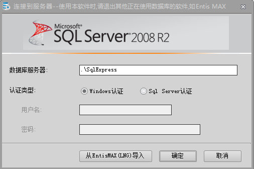

# 使用DBTools分离数据库

‍

---

### 一：启动DBTools数据库管理工具

在程序的安装目录下找到 DBTools 目录进入此目录，找到 EntisDBTool.exe 这个执行文件，双击执行或者在开始菜单中找到相同程序入口。

### 二：连接数据库服务器

### 三：选择目标数据库执行分离

在目标数据库上点击右键，在右键菜单中选择菜单【分离数据库】，执行成功后，分离的数据库会在界面上消失。

### 四：注意事项

- 背景色为红色的数据库，有可能无法分离，此时请首先确保权限允许；如权限允许依然无法分离，请先设置为脱机状态，然后执行数据库删除操作（脱机后删除不会删除实际数据库文件）。一般出现这种情况，数据库文件已无法简单修复，需要使用备份的数据库文件来还原。
