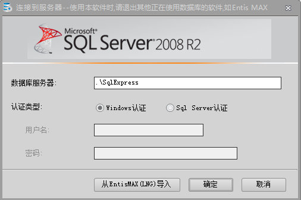
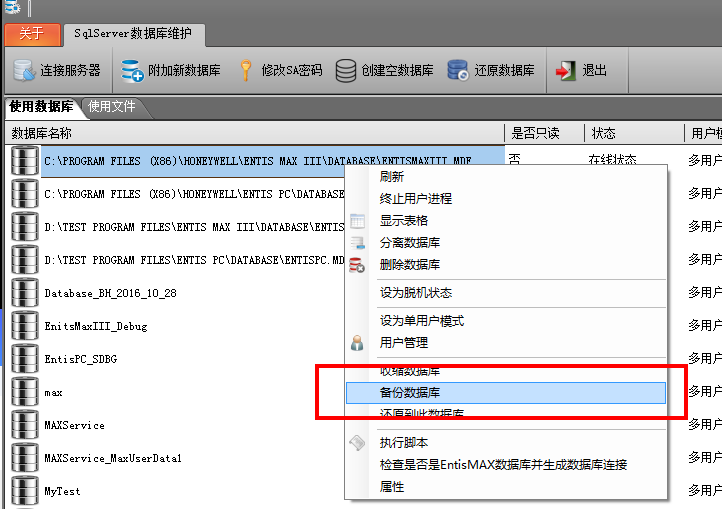
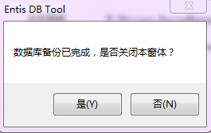

# 使用DBTools备份数据库

‍

---

### 一：执行DBTools数据库管理工具

在程序的安装目录下找到 DBTools 目录进入此目录，找到 EntisDBTool.exe 这个执行文件，双击执行或者在开始菜单中找到相同程序入口，效果相同。

### 二：连接数据库服务器

### 三：选择目标数据库后，点击右键，在右键菜单中选择备份数据库

### 四：选择备份目录，点击开始备份按钮，执行备份过程

### 五：显示如下窗体，表示备份完成

