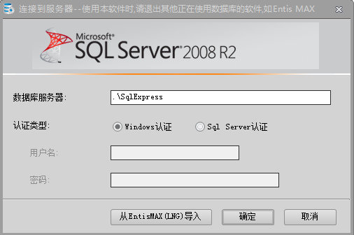

# 使用DBTools还原数据库

‍

---

### 一：启动DBTools数据库管理工具

在程序的安装目录下找到 DBTools 目录进入此目录，找到 EntisDBTool.exe 这个执行文件，双击执行或者在开始菜单中找到相同程序入口。

### 二：连接数据库服务器

### 三：选择目标数据库执行还原

在目标数据库上点击右键，在右键菜单中选择菜单【还原到此数据库】，如下图：
