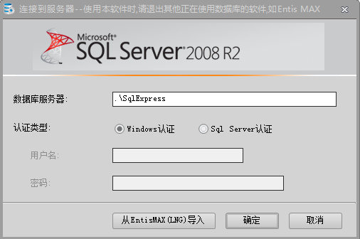

# 使用DBTools附加数据库

‍

---

### 一：启动DBTools数据库管理工具

在程序的安装目录下找到 DBTools 目录进入此目录，找到 EntisDBTool.exe 这个执行文件，双击执行或者在开始菜单中找到相同程序入口。

### 二：连接数据库服务器

### 三：附加数据库

在工具栏菜单上，点击菜单【附加数据库】，显示附加窗口，如下图：

- 如附加不成功，请确保当前数据库文件权限已分配，或者确保数据库文件未损坏。
