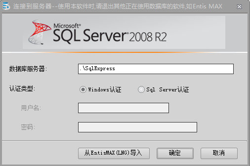
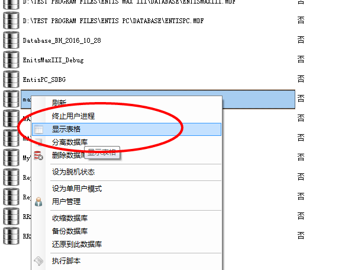
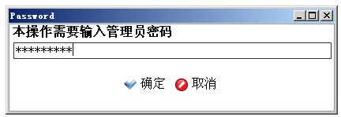

# 使用DBTools高效清除历史数据

‍

---

### 一：执行DBTools数据库管理工具

在程序的安装目录下找到 DBTools 目录进入此目录，找到 EntisDBTool.exe 这个执行文件，双击执行或者在开始菜单中找到相同程序入口，效果相同。

### 二：连接数据库服务器

### 三：选择目标数据库后，点击右键，在右键菜单中选择显示表格

### 四：输入工程师密码：wenejiang

### 五：显示如下窗体，在左侧中找到历史数据表格TM\_Tank\_Data\_History,然后在窗体右下角找到清空按钮，点击此清空按钮，此表格数据可以快速清空

在窗体左侧找到历史数据表格 ​`TM_Tank_Data_History`，然后在窗体右下角找到清空按钮，点击此清空按钮，此表格数据可以快速清空。
