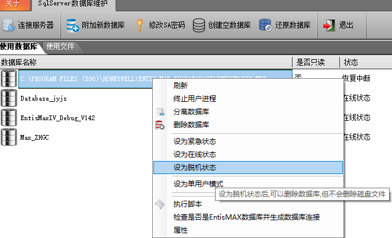

# 数据库文件状态显示恢复中断处理

‍

---

### 1:问题描述

打开数据库管理工具时，数据库背景色为红色，且状态显示为"恢复中断"，如下图：

### 2:问题分析

- 原因：数据库文件出现问题，如突然停电、权限损坏、硬盘坏道、病毒破坏等各种原因。像突然停电、权限损坏等导致的一些轻微故障，可以通过下面的方法进行尝试修复；但如硬盘出现坏道等一些严重的故障原因，数据库文件无法简单修复，一般只能通过还原备份文件方式修复（并且要更换硬盘处理）。

### 3:数据库轻微故障修复说明

- 方法一：首先检查权限，确保权限可用（权限设置方法请参考[如何设置数据库权限](https://softcool.cn/entis-max-default/如何设置数据库权限/)），然后设置为脱机状态，再设置为在线状态，可解决权限引起的故障，如下图：

  
- 方法二：如通过以上方法未修复数据库故障，则可以尝试通过分离数据库，再附加的方式来修复
- [使用DBTools分离数据库](../使用DBTools分离数据库.md)
- [使用DBTools附加数据库](../使用DBTools附加数据库.md)
- 方法三：通过以上方法无法修复,一般修复难度会比较大，建议使用备份文件来还原，参考 [使用DBTools还原数据库](../使用DBTools还原数据库.md)

### 4:注意事项

>> *如无法通过以上方法修复，请联系系统服务商或开发商。*
>>

‍
