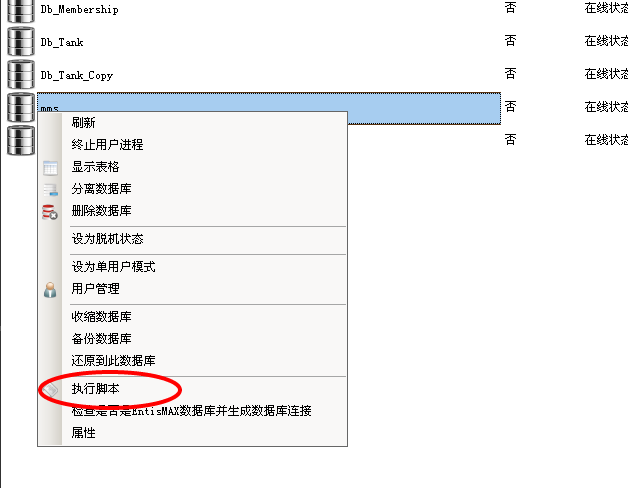
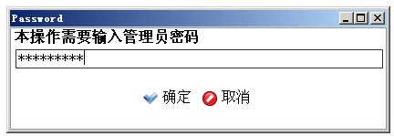
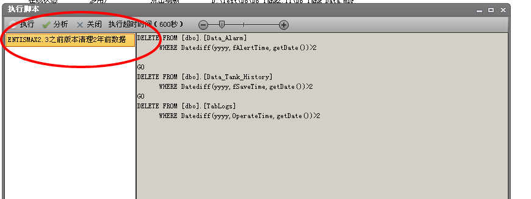

# 执行脚本功能说明

‍

---

有时候，需要执行一些特殊的数据库操作，如添加、修改、清除特定的数据，或执行数据库修复、清理等维护操作，可以通过使用本管理工具执行脚本来实现，此脚本由开发商提供（现成的脚本或联系开发商定制）。

### 二：放入脚本

得到脚本文件后，需要放入指定的目录才能使用，默认目录为：

- 如实际安装目录不同，请相应调整
- 如Scripts目录不存在，手动创建

### 三：执行脚本

1. 右键点击数据库，选择【执行脚本】。
   
   输入工程师密码：​`wenejiang`。
   
   选择脚本，然后点击【执行】按钮；如果为了慎重起见，也可以先点击【分析】按钮，确认脚本分析没问题后，再执行。
   
