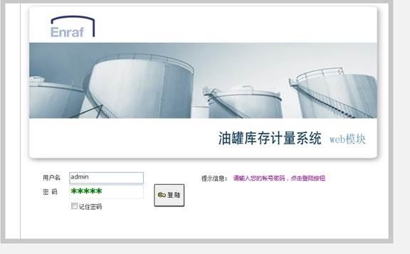
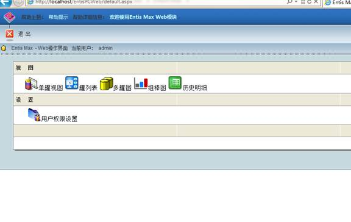
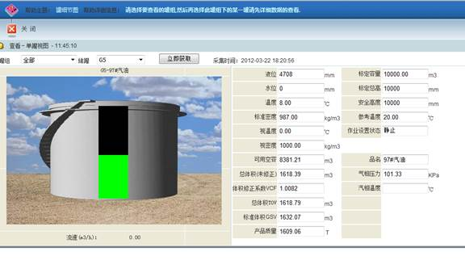
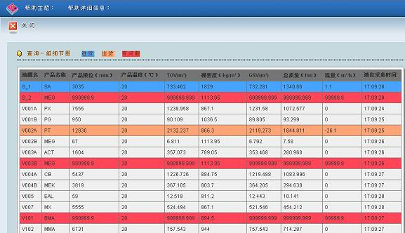
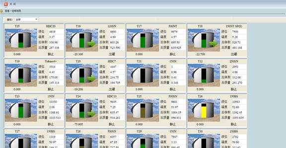
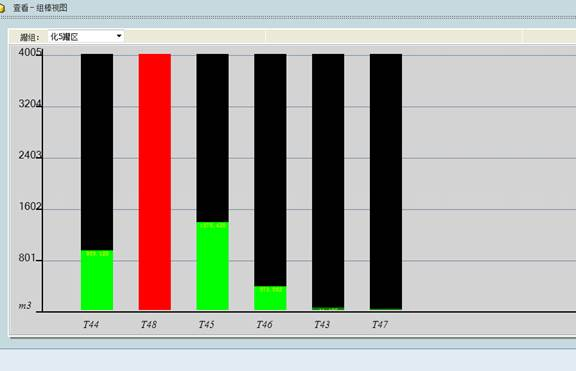
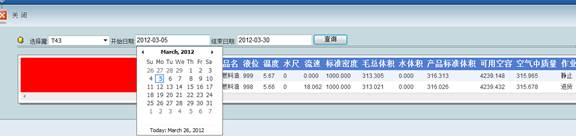
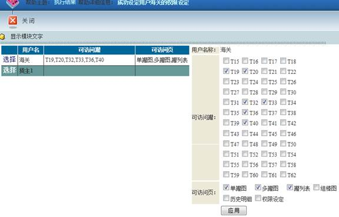

# 使用说明

### 登陆界面

打开 IE 浏览器，输入网站地址后，打开登录界面，输入用户名和密码后回车；如果密码正确，即可登入到首页。如果希望一段时间内都不用进行用户名和密码验证，直接进入首页，则可以勾选【记住密码】选择框。

用户可以自定义登陆界面的显示图像，修改成企业自身的宣传界面．

### 首页

进入首页以后，会根据选择的功能模块显示多个不同的图标，默认界面显示 5 个查看界面和 1 个设置界面。

### 单罐图

用户可以选择不同的罐组和罐，默认系统的刷新时间为 10 秒一次。用户可以修改配置文件刷新速度，也可以点击【立即获取】，系统会立即刷新；但最快速度取决于库存计量软件刷新实时数据的速度。

### 罐列表

以表格的方式显示罐数据，并按设置的刷新时间刷新，不同的作业状态显示不同的背景颜色。

### 多罐图

以精简的方式显示多个罐的罐图，比较直观地显示整个罐区存储情况。每个罐的颜色能够根据存储的产品变化，能够显示当前作业状态和流速，基本上与库存计量软件的多罐图显示一致。

#### 组棒图

以组棒图的形式，显示不同罐的体积情况。与多罐图相比，本图能够根据罐的体积大小，生成不同的高度显示，直观地显示每个罐的总容、空容与存储产品的体积分布情况。这个图只有在 Web 界面上才有，在库存计量软件上没有。

### 历史数据

通过 Web 也能查询所有罐的历史数据。一次性查询数据过多的话，能够自动分页显示。

### 权限设置

本权限的用户帐号以库存计量软件中的货主帐号为基础，拓展了在 Web 界面上使用时的操作权限设定。可以为每一个帐号设定显示不同的罐和使用不同的显示页面。

