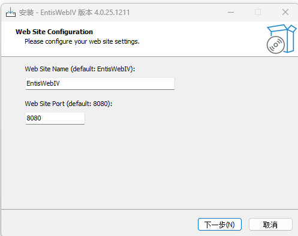
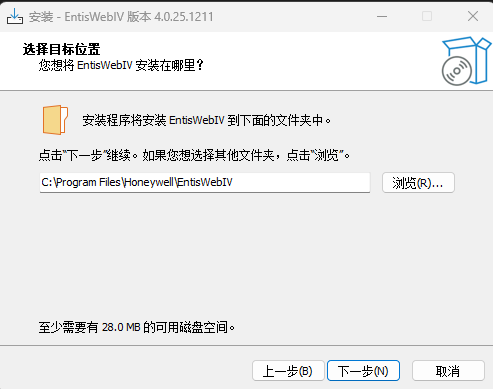
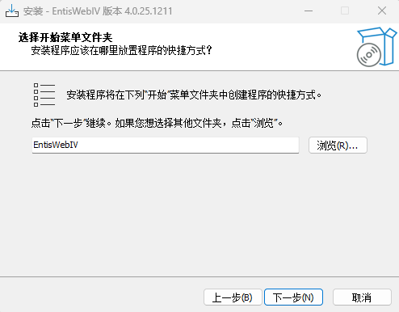
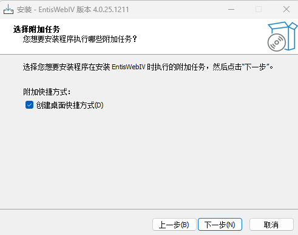
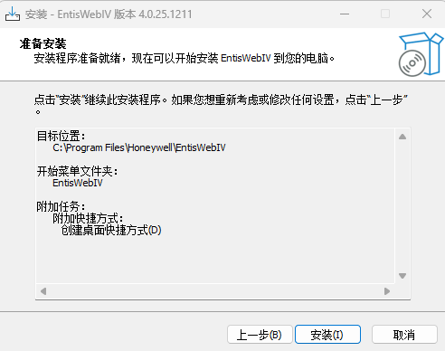
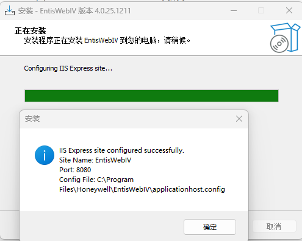

# 安装说明

# 安装说明

安装说明

#### 一：运行安装程序以后，首先显示如下界面

- 第一个填写项 **Web site name**：主要用来在 Web 服务器中注册 Web 服务名称，不影响实际访问路径，一般无需修改。
- 第二个填写项,比较重要,用来定义访问Web的端口号,如无特殊需要,保持默认8080即可.

#### 二：设置安装路径,没什么特殊情况，请保持默认值，然后点击下一步

#### 三：设置开始菜单组名,没什么特殊情况，请保持默认值，然后点击下一步

#### 四：选择是否创建桌面图标,默认创建

#### 五：确认安装配置信息,下一步后程序开始安装，请等待安装完成

#### 六：EntisWeb管理工具设置

安装完成后，点击EntisWeb管理工具图标，运行管理工具

安装完成后，点击 EntisWeb 管理工具图标，运行管理工具。

- 服务器名称：本机默认是 ​`.\SqlExpress`​；如数据库不在本机，则把点改成目标主机的 IP 地址，例如 ​`192.168.1.2\SqlExpress`。
- 验证模式，如本机，可使用windows认证，否则请使用SqlServer身份验证模式，然后输入相应的用户名和密码
- 目标数据库名称，如不在本机的，请把目标服务器中的数据库连接方式改成附加的逻辑名称，然后在此处使用逻辑名称连接
- 设置完成后，点击测试连接，确保可以正常连接，然后点击保存连接。

**第二步：生成桌面快捷方式（可选）**
