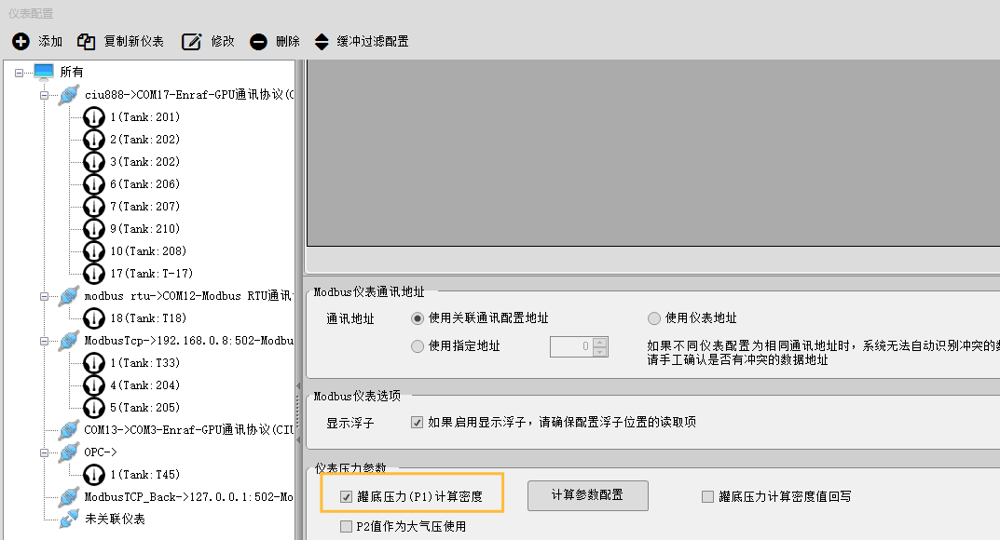

# 使用软件计算Hims密度功能

##### 第一步，在仪表配置中开启Hims密度计算功能

##### 第二步，配置详细的Hims密度计算参数

开启计算选项后，点击边上的【计算参数配置】按钮，进入具体参数配置界面，如下图：

##### 第三步，如果要使用软件计算密度作为视密度计算标准密度，请在罐实时参数设置中，开启2个选项

1：勾选读取密度设备时自动转换标准密度  
2：勾选标准密度来源中的其他测量密度
