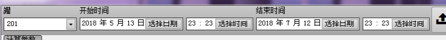
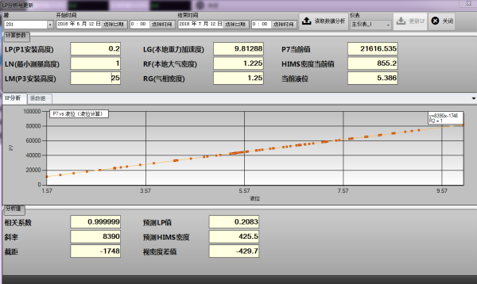
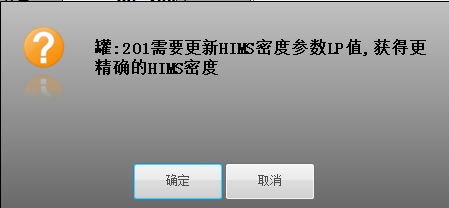
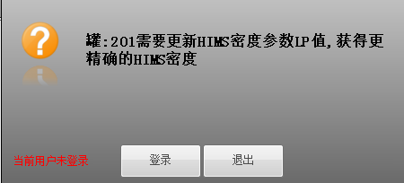
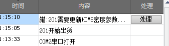
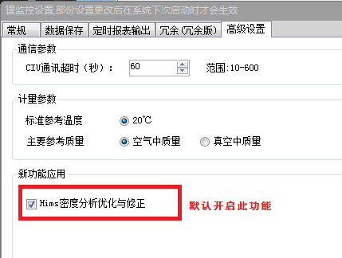

# HIMS密度分析优化并更新LP参数值

# HIMS密度分析优化并更新LP参数值

HIMS密度分析优化并更新LP参数值

为了更好的使用HIMS密度，满足HIMS密度需要不断优化调整的需要，EntisMax中加入了HIMS密度分析优化功能，通过不断跟踪记录罐的作业历史记录，分析趋势，并根据回归趋势算法，求出更加合理的LP参数值，通过更新仪表的LP参数值，让液位计的HIMS密度值更加精确与真实
下面，根据软件功能版本的不同，分别描述相关的使用说明

### 标准版实现功能

标准版可以通过手动打开功能界面，打开此界面，需要管理员设置过权限并登陆，否则不能打开

在界面上选择记录的历史时间范围，软件会导入操作者指定的时间范围内的静态记录，并执行分析计算（*注意，软件为了稳定运行，限制最多导入最近的1万条记录，所以，时间范围选择过长，没有意义*）

使用此功能前提，要求在巡检命令中加入BZP7命令，并最好是BZP7和BB命令设置为连续执行，P7的值也将会记录在历史记录中，虽然，软件为了更好的兼容性，也允许导入无P7的数据记录，然后计算得出，但没有实时的数据记录来得好，所以推荐在巡检命令中加入BZP7命令

软件界面如下：

图一

- 用户可以选择罐来切换针对不同罐进行操作，
- 如果一个罐下面有多个仪表，在更新LP参数值之前，需要确定选择哪个仪表更新操作

软件会根据回归算法求得的LP参数值来计算预测的视密度值，然后会与当前HIMS密度值作对比，由用户来确定是否要通过更新LP值，来调整液位计的HIMS密度值，用户也可以通过参考相关系数，R2值来综合参考

### 专业版功能

专业版在标准版的基础上增加了自动判断功能，软件会跟踪一个罐的作业情况，当罐完成一个作业循环后（从上一个进罐完成静止到下一个进罐完成静止为一个循环），会跟踪此循环的前后时间，自动读取此范围内历史记录，并执行相关分析算法，求出LP值，并预测HIMS密度值，当预测的HIMS密度值与当前HIMS密度值差值超过指定值时，就会提醒操作员是否更新LP参数值，如图：

如果，此时操作员没有登录帐户，则会显示如下界面：

如果，操作员未在现场，或长时间不操作，则此提示框会自动关闭，并在事件中心进行提示，如图：

操作员可以随时点击“处理”按钮，执行处理（请注意，此处理按钮会在软件重启后或一个比较长的时间后会失效）.

实际更新处理界面跟标准版一致，只不过会自动帮操作员选择好指定的罐，指定的时间范围，更新LP值操作都与标准版一致

♦由于此功能刚推出，所以暂时不开放自动更新LP参数值功能，等适当的时候，再开放

♦ 如果，用户不想使用此功能，也不想被提醒，则可以通过配置关闭此功能，关闭此功能后，界面上的操作菜单也会隐藏起来

关闭配置界面如图：

