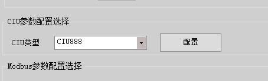

# Modbus协议下伺服密度50点配置说明

## 如要配置超过默认点数的伺服密度，需要注意如下几个配置项

#### 第一项，修改通讯配置中的CIU配置选项

#### 第二项，仪表配置中的自动重复次数配置

在仪表的相应字段下设定重复次数，如有 50 个点，则设置为 49 次重复：

#### 第三项，在Modbus输出时，也需要指定重复次数

跟输入时一样，如果总共有 50 个点的数据，则指定重复次数为 49：
