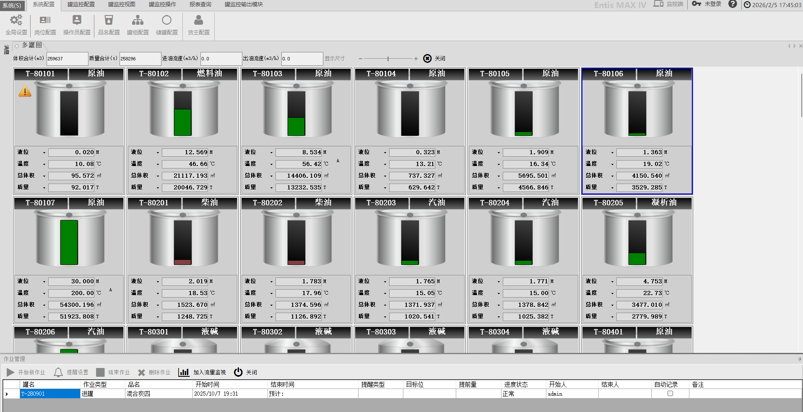
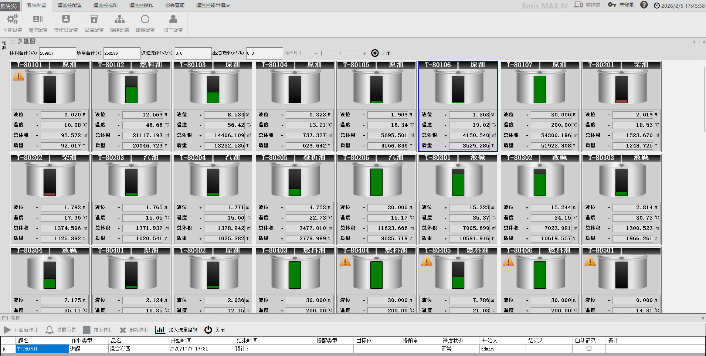
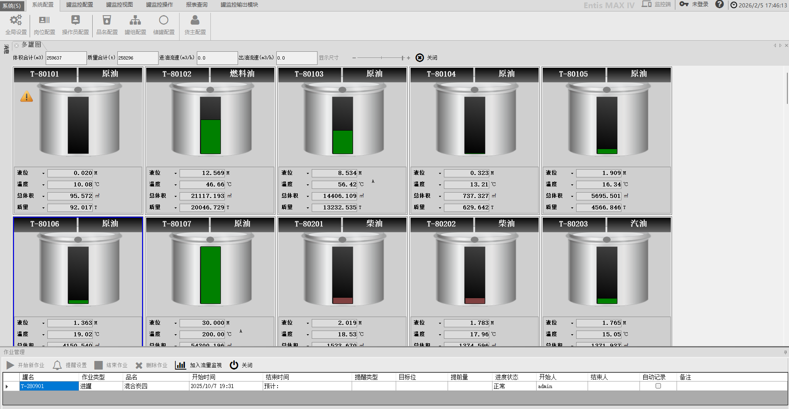
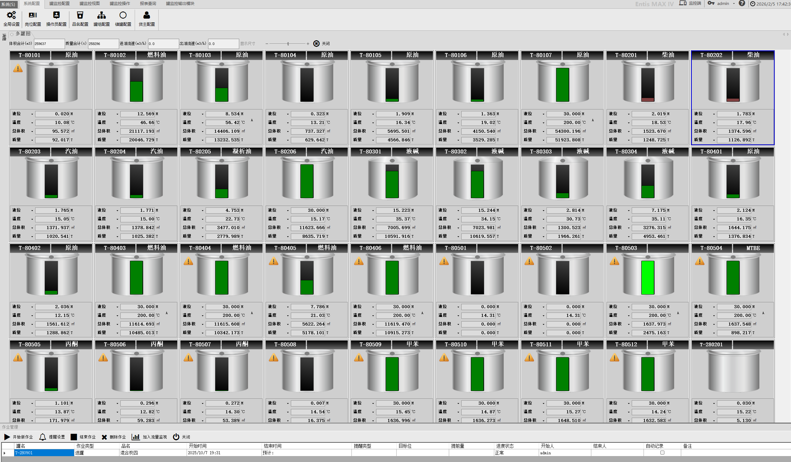
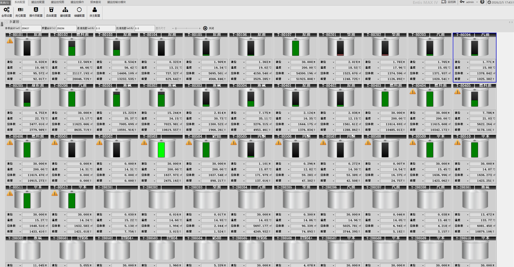
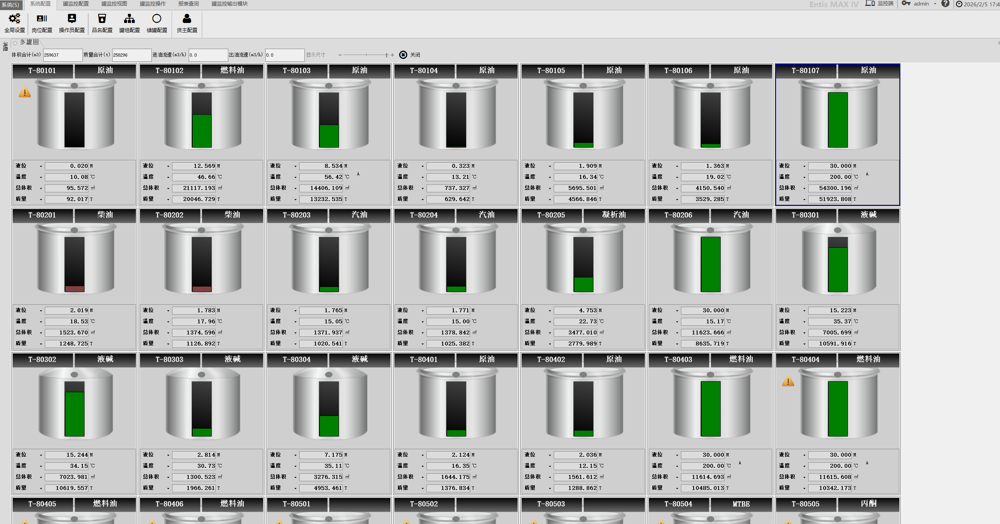
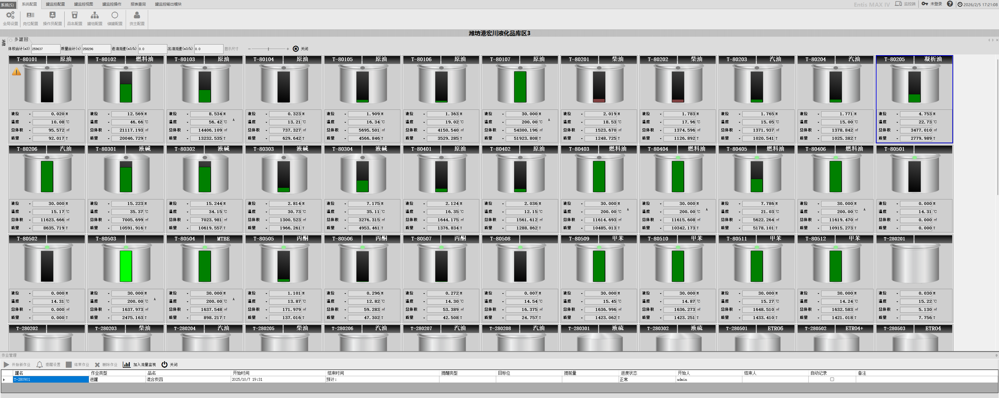
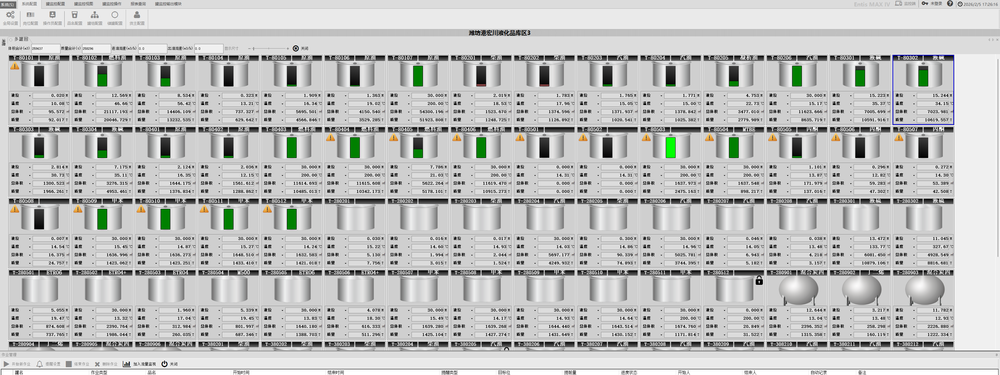
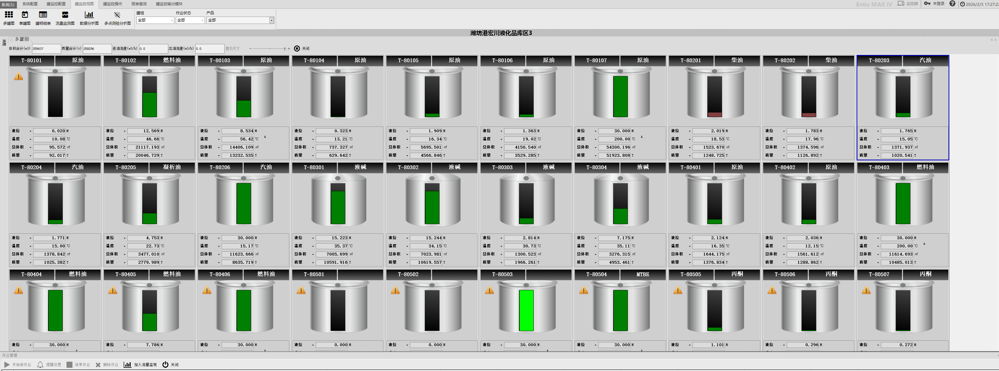
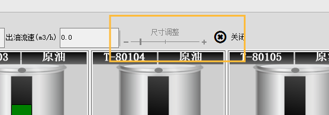

# 多罐图分辨率适配说明

首先，在显示设置中，调整缩放为 100%，然后根据不同分辨率显示。

### 一：1920 × 1080（以前的推荐分辨率）

默认尺寸（6个）：

最小尺寸（8个）：

最大尺寸（5个）：

### 二：2560 × 1600（当前推荐分辨率）

默认尺寸（9个）：

最小尺寸（11个）：

最大尺寸（7个）：

### 三：3440 × 1440（大罐区推荐分辨率）

默认尺寸（12个）：

最小尺寸（15个）：

最大尺寸（10个）：

### 四：显示尺寸的调整

多罐图上工具栏尺寸调整按钮，往小和往大调，各有 5 档可调。如下图：

### 五：版本说明

- 4.7.26.210 之前版本，不支持尺寸调整；之后的版本支持尺寸调整。
