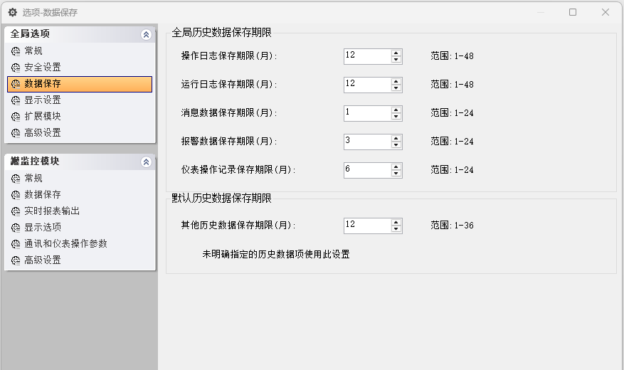

# 大罐区软件性能优化指南

‍

当软件配置较多罐数时,同时电脑性能又不佳的情况下,性能问题就会显现出来,可能会导致软件运行异常,严重情况下,系统崩溃,数据丢失.所以在软件里进行适当的配置优化是必要的.配置优化的目的是为了系统能正常稳定运行,主要策略是通过减少数据保存,数据计算等方式

#### 第一步，减少全局数据保存期限

打开菜单“系统配置/全局设置”，在打开的窗体中，选择数据保存这一项，如下图：

#### 

#### 第二步，减少罐监控模块中的历史数据和实时数据保存

打开菜单 "罐监控配置/选项"，在打开的窗体中，选择数据保存这一项，如下图：

#### 第三步，适当调慢定时任务项

如果有配置较多的定时任务项，则请适当调慢定时间隔，一般定时任务项有如定时备份数据库，定时导出报表，定时执行仪表命令（伺服密度，多点温度，测水等）

#### 第四步，适当调慢通讯轮询时间

这个根据通讯的情况适当调整，其中重要的参考依据是通讯收发的时间差，通讯轮询间隔不要小于通讯的收发时间差：

- 如果有Modbus输出模块配置的，则在第三方系统如DCS中，适当调慢轮询间隔，可以减轻软件负荷。

#### 第五步，缩减罐容表

有些罐容表数据量非常大，可能一个罐会超过 1 万多条记录。罐数不多时，无需优化；但当罐数较多时，罐容表表格总记录数会比较大，也会导致性能问题（罐容表总记录数控制在 100 万行以内）。此时，请适当缩减罐容表。比较简单的一个方法是重新导入时，采用隔行导入的方法，间隔一行，就可以缩减一半的罐容表：

#### 第六步,安装大容量数据库版本

默认安装的数据库版本是Express版本，此版本有免费授权，一般情况下，可以满足现场使用，但如果罐数较多，历史数据保存期限较长，且希望还能保证数据库读写性能的情况下，则有必要使用开发版本的数据库，此版本数据库在无互联网联接的情况下使用是可以的。
下载链接：[英文版下载](https://res.softcool.cn/d/kuake/Software/SqlServer/SqlServer2017/SqlServer2017_Developer_EN.zip)​[中文版下载](https://res.softcool.cn/d/kuake/Software/SqlServer/SqlServer2017/SqlServer2017_Developer_CN.zip)

#### 第七步，升级硬件

经过以上优化步骤，如果依然还是遇到性能问题，则最有效的办法就是升级电脑硬件，重点升级对像是硬盘，推荐升级高性能的固态硬盘，性能较强的硬盘有较快的读写速度，可以让数据读写顺畅完成。升级CPU和内存也能有效提高软件执行效率，在预算充分的情况下，推荐升级到当前主流配置。
