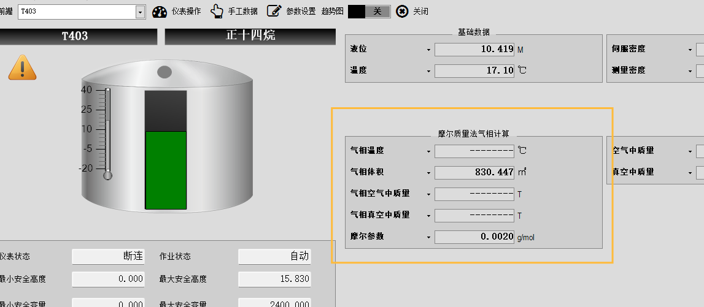

# 气相计算功能开启说明

‍

#### 第一步:要开启气相计算的开关,默认并没有开启,会跳过气相的计算

操作说明：点击选择目标罐，然后点击右键或上部工具栏中选择 "罐实时参数配置"，显示如下窗体，选择 "罐计算参数配置"，勾选 "是否气相校正"，再点击应用保存：

#### 第二步:配置气相计算需要的基础参数

基础参数分为 2 种方式：是否使用摩尔参数或液相气相比，此参数主要根据产品配置。

###### 如使用摩尔参数计算，请选择摩尔质量法，然后输入摩尔值，如使用气相液相比计算，则输入相应的气相/液相比，然后点击确定保存

#### 第三步：添加气相计算需要的输入基础数据

气相计算主要的输入基础数据为气相压力和气相温度，主要在仪表配置中配置相关的数据的读取项。

#### 最后，打开相应罐的单罐图，即可显示气相计算相关值

