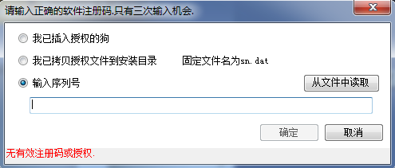
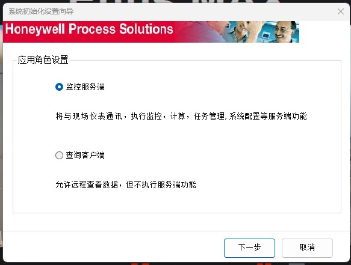
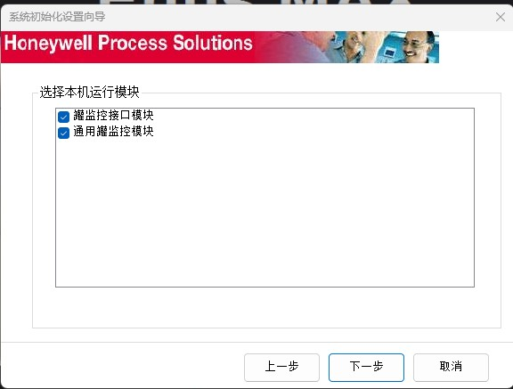
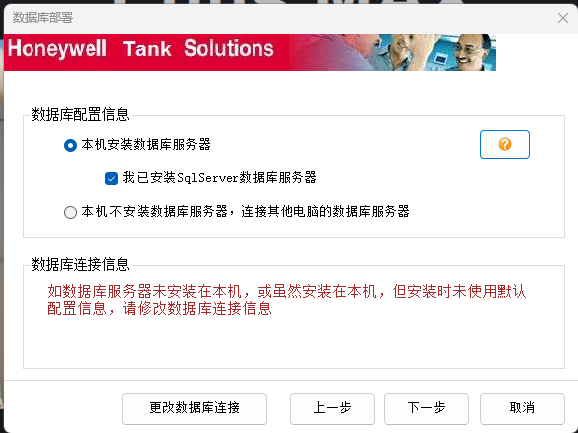
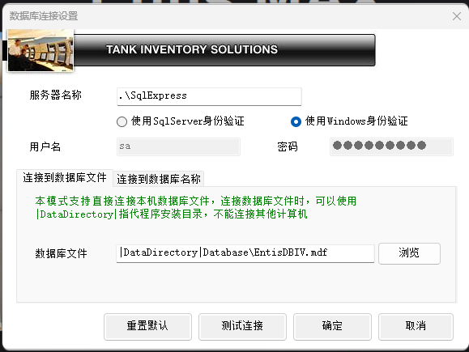
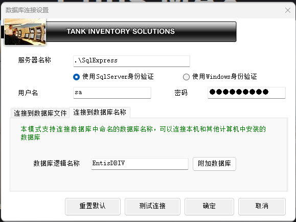
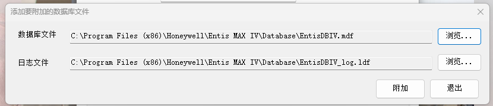

# 初始化设置向导

---

#### 第一次运行系统，会显示初始化设置向导，帮助启用系统

#### 1:注册界面

  如果电脑没有插入授权的软件狗,则第一次运行会要求插入软件狗或输入临时试用的序列号,此时插入软件狗或输入序列号继续下一步

图1：

### 

#### 2:应用角色设置

   此界面主要确定当前电脑运行的运行角色,是作为监控服务端运行还是查询客户端运行,如下图:

图2：

#### 3：授权运行模块选择

    界面中会列出当前软件狗已经授权的运行模块，此处可以确定本机实际运行的功能模块

图3：

### 4:数据库配置

    在运行初始化前，请先确保已经安装好合适的数据库版本，如当前安装的数据库设置同默认的不一致,则请点击按钮"更改数据库连接"修改,否则数据库无法连接,界面如下图

 图4：

- 如您已安装数据库.则请选上”我已安装…”的标签,[执行下一步操作](#初始化操作员设定).
- 如您选择的是本机不安装数据库服务器,则需要点击按钮“更改数据库连接”，配置数据库连接
- 如您上一步勾选的应用角色为客户端，则此处必须通过点击按钮“更改数据库连接”，配置数据库连接，因为客户端不能使用本机默认的数据库文件，需要连接监控服务端数据库

#### 5:数据库连接设置

连接数据库有二个方式：

- 连接到数据库文件，是系统默认的数据库连接方式,连接的数据库为软件安装目录下面的Database目录下面的数据库文件,如需要连接放置在其他地方的数据库文件,连点击浏览，选择相应的数据库文件即可。

     图5：

- 连接到数据库名称，此种方式可以简化客户端、Web模块、其他应用模块或第三方服务端开发的系统连接我方的数据库。另外，如数据库服务器在另外一台电脑上，也需要使用此种方式来连接。如原来没有指定过数据库的逻辑名称，则
- 请先输入要使用的名称，然后点击 "附加数据库" 按钮，选择要附加的数据库即可。

  

     图7：

 

#### 6:初始化操作员设定

系统已配置了默认操作员,如果不需要马上设置管理员新密码，可以直接跳过这一步,如确认系统没有配置任何默认操作员或需要重置管理员密码,则可以取消勾选项，然后执行帐号和权限的初始化操作。界面如下图:

   图8：

- 初始化会清除所有原有的帐号和权限配置，并初始化为默认数据，请慎用！

 

### 8:初始化向导完成

**运行到此处****,**则初始化向导完成**,**您可以正常登录系统**,**进行相关设置**.**界面如图**:**

