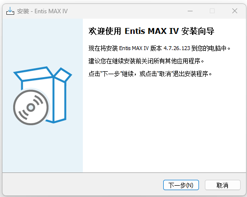
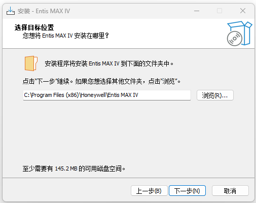
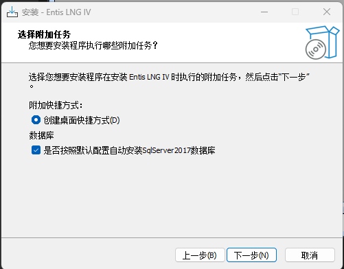
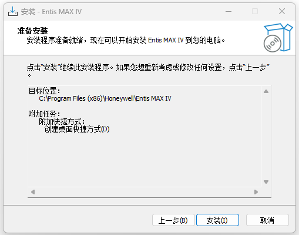
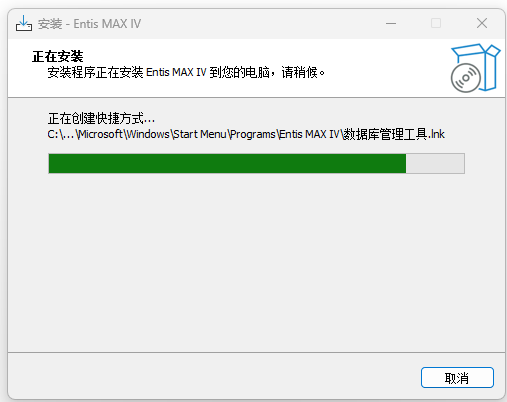
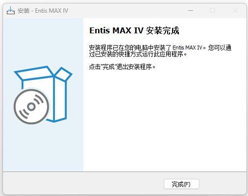
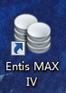

# 安装说明

## 主程序的安装过程

---

#### 1:双击执行EntisMax安装包中的安装文件,名称格式为EntisMAX[版本号]\_Install.exe

- 如果已经安装了兼容的旧版本,则运行新版本安装文件会执行升级打补丁的功能

#### 2:如果弹出以下界面，表示可以正常安装，请点击下一步继续。

#### 3:你可以自定义安装路径和其他选项，推荐保持默认，直接点击下一步

#### 4:选择安装路径后，下一步是附加任务。除了是否创建桌面快捷方式，还有一项：

**是否按照默认配置自动安装SqlServer2017数据库**

**这一项默认不勾选。**

- 不勾选：只安装主程序，不安装、不改动数据库。本机已经有可用的 SQL Server 时，保持不勾选即可。
- 勾选：主程序文件安装完成后，再按默认配置安装或配置 SQL Server 2017 Express。这一步可能需要几分钟，安装过程中请不要关闭窗口。

**勾选后的默认配置如下：**

- 实例名：`SQLEXPRESS`
- 启用 SQL 身份验证，sa 密码为w****g( 常用密码)
- 启用 TCP协议通道
- SQL Server Browser 设为自动启动
- 当前安装用户加入 SQL 管理员
- 防火墙放行该实例，并放行 SQL Browser 使用的 UDP 1434 端口
- 为程序目录下的 `Database` 文件夹授予 SQL 服务账户访问权限

如果本机已经安装了 `SQLEXPRESS` 实例，不会重复安装，只按上面的配置处理。

安装程序优先使用与主程序安装包放在同一目录的 `SQLEXPR_x64_CHS.exe`。找不到这个文件时，会提示手动选择 SQL Server Express 安装包。取消选择则跳过数据库安装，主程序本身仍然安装完成。

数据库安装未完成时，会提示退出码，并请查看 `C:\Program Files\Microsoft SQL Server\140\Setup Bootstrap\Log`。若提示需要重新启动计算机，请先重启，再使用数据库。

#### 5:看到此界面，您可以开始安装了，请点击下一步。如果上一步勾选了自动安装数据库，此页“附加任务”中会列出该项。

#### 6:正在安装，请稍待...

#### 7:看到此窗体，表明安装已成功完成，请点击关闭按钮即可

#### 8:安装完成以后，会在桌面和开始菜单分别生成快捷方式，您可以点击运行程序。

