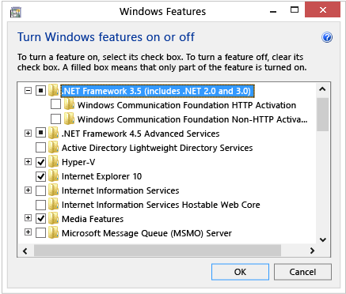

# 在控制面板中启用 .NET Framework 3.5

可以通过 Windows 控制面板启用 .NET Framework 3.5。 此选项可能需要 Internet 连接。此功能适用于windows7及以上操作系统，这些操作系统的内核已经集成Net framework3.5

1. 

   无需选择"Windows Communication Foundation (WCF) HTTP 激活"和"Windows Communication Foundation (WCF) 非 HTTP 激活"的子项，除非是需要使用此功能的开发者或服务器管理员。

♦如果电脑无法联机，无法通过此方法安装.Net Framework,[请参考离线安装方法](https://softcool.cn/2019/07/09/win10离线安装-net-framework-3-5的方法之一使用cab格式离线安装包/)
