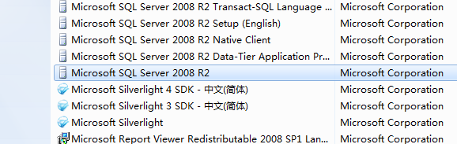
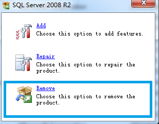
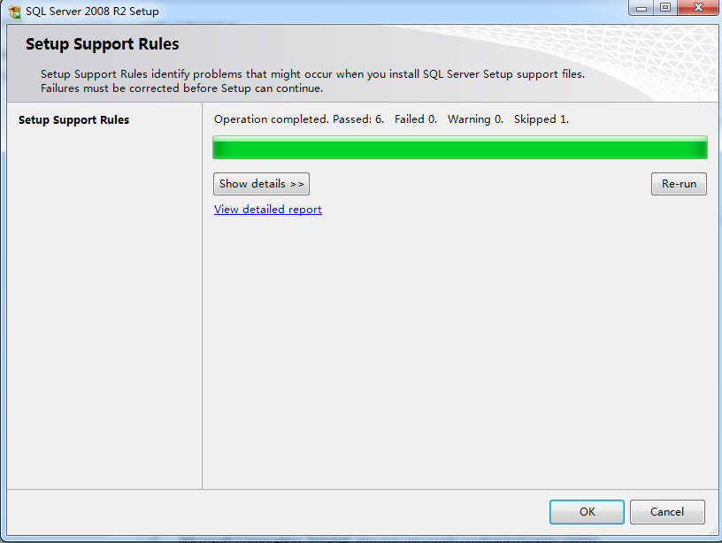
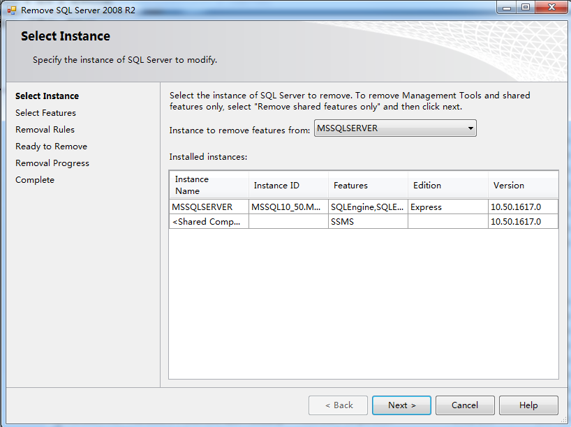
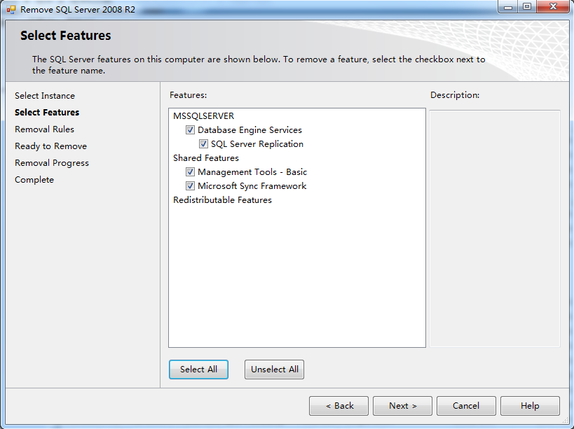
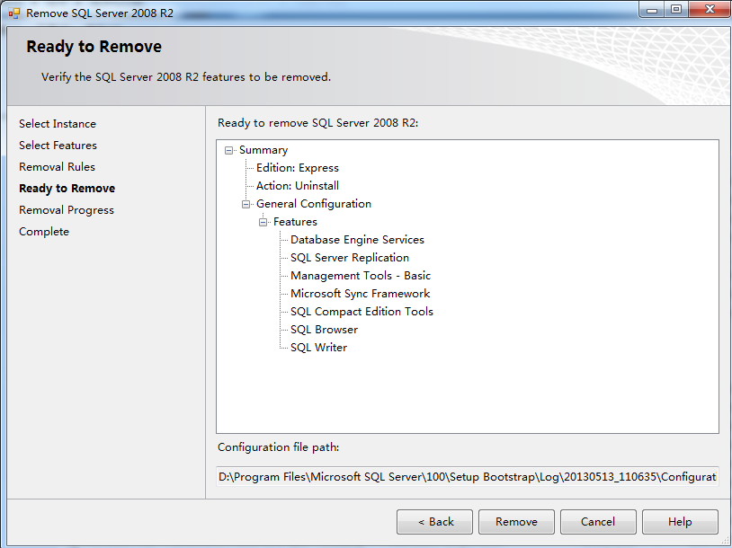
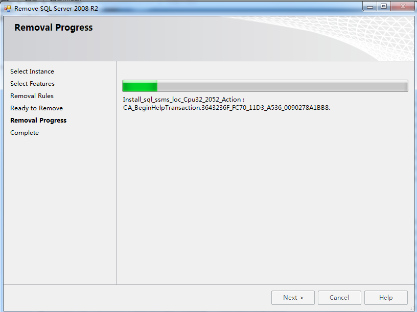
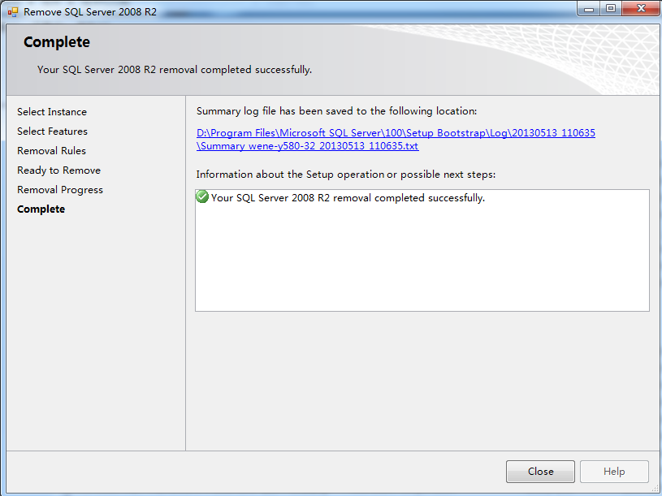

# SqlServer卸载(适用于2008R2,2014,2017)

---

### 1:进入控制面板,找到程序和功能(在Xp中是添加和删除程序),找到Sql Server,

### 2:点击Remove(中文为移除)

### 3:显示已准备好开始移除,点OK继续

### 4:此处选择要移除的实例,如果只有一个实例,则直接点击下一步继续

### 5:选择要移除的功能模块,可以选择全部

### 6:已准备好开始移除,点击Remove(称除)开始正式卸载.

### 7:下载过程时间较长,需要耐心等待,正常情况是3分钟左右.

### 8:卸载完成

