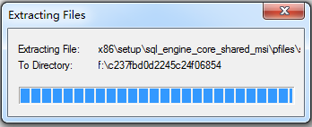
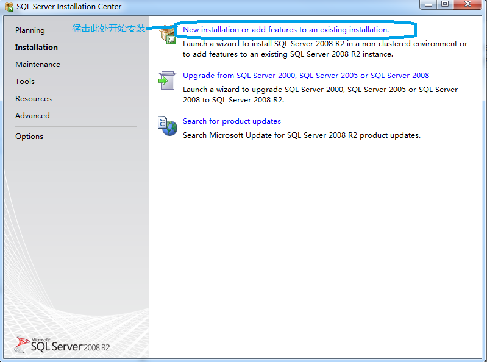
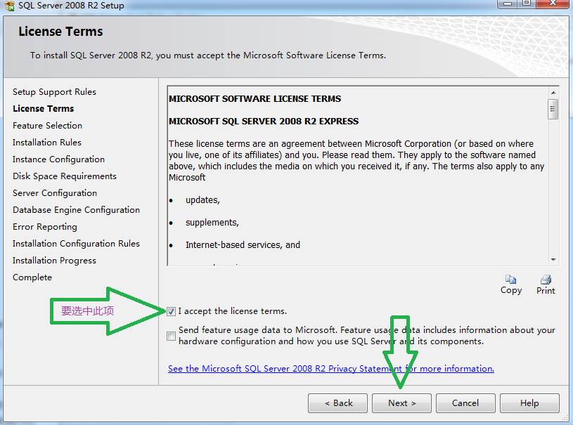
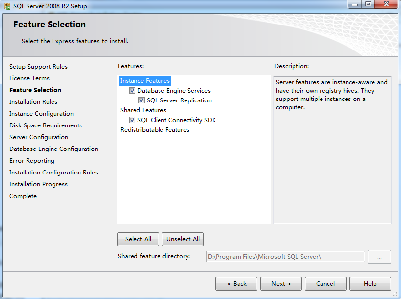
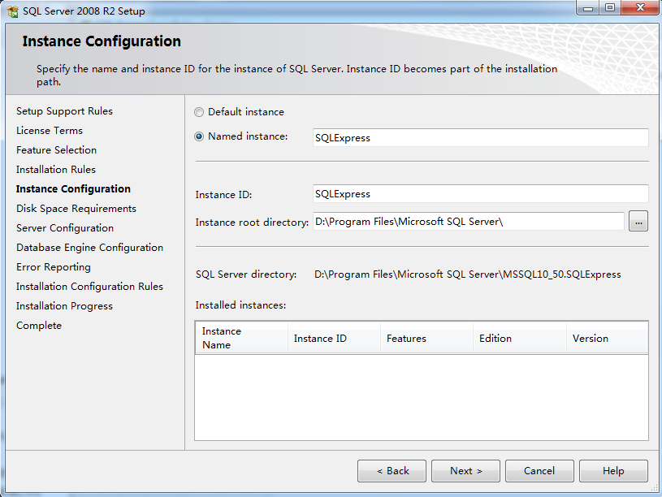
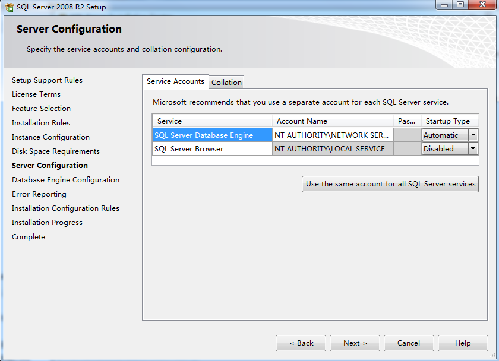
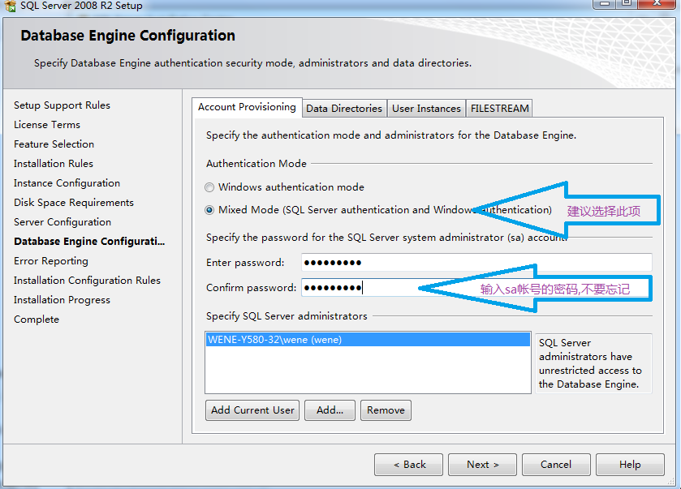
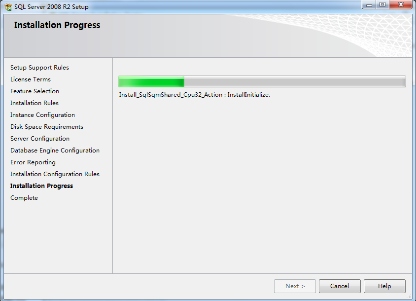
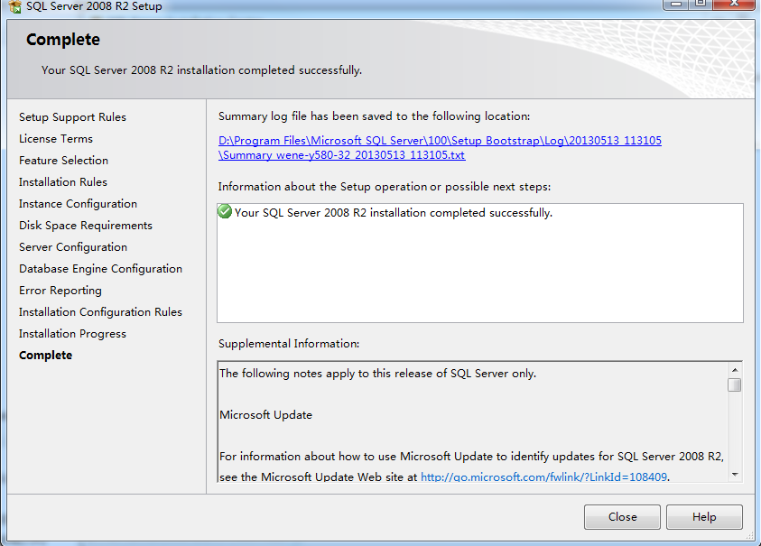

# SqlServer安装(适用于2008R2,2014,2017)

### 1：双击运行 Sql Server 安装包，等待解压缩完成，如图：

### 2：解压缩完成后，显示安装界面

### 3：用户协议确认，选择接受此协议，然后点击下一步

### 4：选择安装模块，建议全部选中，然后点击下一步继续

### 5：进入安装实例配置界面，建议保持默认（SqlExpress），不用修改，然后点击下一步，继续

### 6：进入服务角色配置界面

此处如已默认选择，则保持默认即可；如果没有默认选择，请按如下选择：

- Sql Server Database Engine：选择 Network Service，启动类型选自动。
- Sql Server Browser：选择 Local Service；如果本机数据要对外开放，则启动类型选自动，否则选禁用。

### 7：进入服务器认证方式配置

如果数据库要对外开放，请选择混合认证（建议）；如果确认数据库不对外开放，也可以保持默认。其他几项都保持默认即可。

### 8：后面几步保持默认，直到安装开始

安装时间稍长，请耐心等待，正常情况下一般在 5 分钟左右即可完成安装。

### 9：安装完成

