# 数据库开放网络接口说明

## 一. 修改数据库连接配置：

##### 

#### 1.  如果需要对外部电脑开放SQL数据库网络服务，需要使用"连接到数据库名称"这一项。如果已配置为连接到数据库文件方式，建议修改为名称方式。否则外部电脑需要以整个数据库文件路径作为连接名称。

    图1:  

#### 2.在连接到数据库名称中，输入要设置的名称，然后点击附加数据库，选择数据库文件进行附加操作

图2:

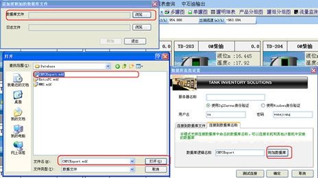

1.  如果数据库附加不成功，提示"主数据库正在被使用"，请退出主程序，使用DBTOOL数据库维护软件来操作附加数据库名称，或者可以尝试输入随意一个名字，但不执行附加过程，也不测试连接，保存退出程序，再启动程序，此时程序会提示无法连接数据库，此时再尝试附加数据库，也有很大的成功率。

## 二. SQL数据库允许网络访问开放配置

#### 1.打开数据库的网络访问功能，在开始菜单中找到SqlServer相应版本的下面选择Sql Server配置管理工具。

图3:

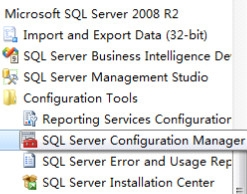

- 如果找不到SqlServer配置管理工具，直接在开始菜单的运行框或搜索框里输入SQLServerManager[版本号].msc,运行即可显示,如Sqlserver2017的名称为:SQLServerManager14.msc

#### 2.检查SQL Server（SQLEXRESS）服务和Sql Server Browser服务正在运行，启动模式是否为"自动"

- 检查SQL
  Server Browser正在运行，启动模式"自动"
- 如果这两个服务没有启动或者不是自动启动，就需要设置到自动，然后重启电脑。注意：Sql Server 代理是不需要开启的。

图4:

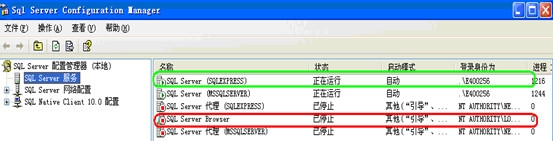

图5:

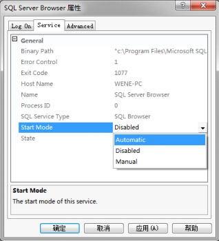

#### 3.开启TCP/IP协议，开启后需要重新启动SqlServer服务或重启电脑。

    图6:

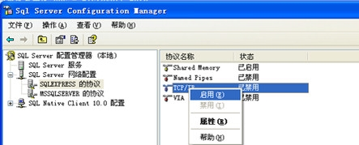

 

    图7:

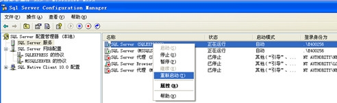

## 三. 防火墙配置

    刚开始时可以先关闭防火墙，等OK后再开启,此处截图为Win11配置，其他操作系统请自行参考

#### 1)在开始菜单中,点击"设置",打开windows控制面板,然后找到windows 安全中心,选择"防火墙和网络保护",再点击"允许程序通过防火墙",如图显示

    图8:

    图9:

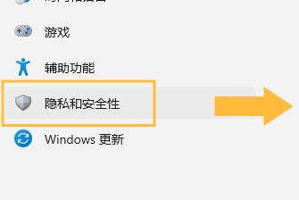

    图10:

    图11:

    图12:

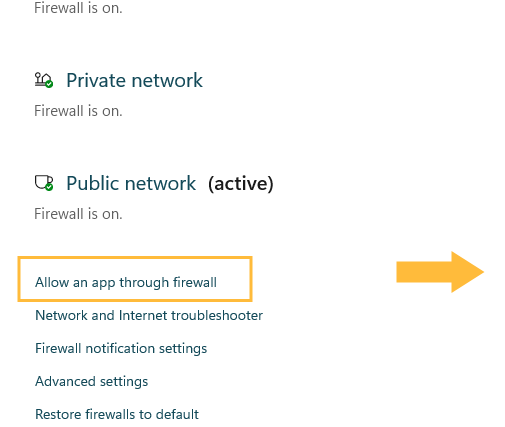

    图13:

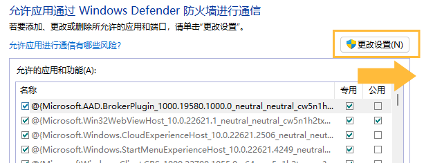

#### **2)在显示的防火墙界面,点击允许其他应用,把sqlserver添加到防火墙的设置项中,如图显示**

    图14:

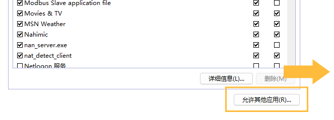

    图15:

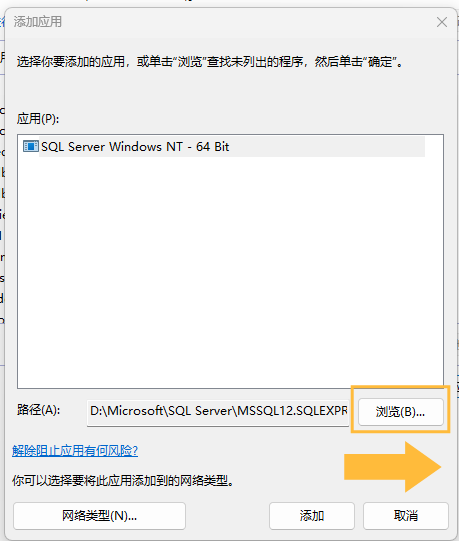

 

- 注意,默认路径一般为 C:/Program
  Files/Microsoft SQLServer/MSSQL.[版本号:2014版为12,2017版为14].[实例名称,默认为SQLEXPRESS]\MSSQL\BINN，选择文件sqlservr.exe即可,
- 如: C:/Program
  Files/Microsoft SQLServer/MSSQL.12,SQLEXPRESS\MSSQL\BINN\sqlservr.exe,如在: C:/Program Files/下未找到类似目录,请到: C:/Program
  Files (x86)/下查找

    图16:

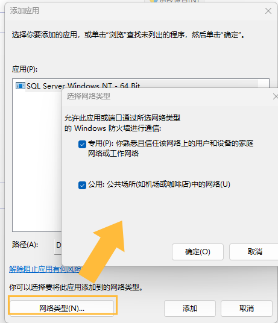

 

- 选择所有网络类型

    图17:

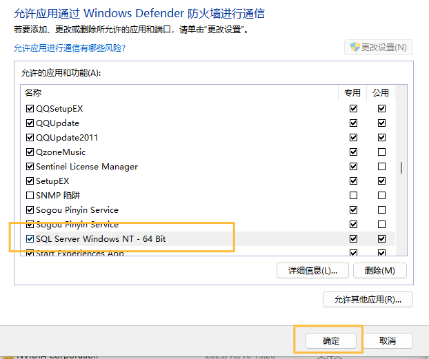

    最后点击确定保存即可

#### 3)用同样的方式,在防火墙中加入Sql server browser服务的执行程序

程序名称为:"sqlbrowser.exe",默认路径是:"C:\Program
Files (x86)\Microsoft SQL Server\90\Shared",如果在默认路径下未找到此文件,请在C:\Program Files (x86)\Microsoft SQL
Server目录下搜索"sqlbrowser.exe"

 

## 四.数据库访问本机测试

1、调试得时候，建议先关闭防火墙，测试外机能不能访问，如果能访问，再去调防火墙，然后关闭360、瑞星等杀毒软件的防火墙。

2、如果主机自我测试，电脑没有连接网线，网卡也没有配置IP地址，这样就无法测试。所以必须将电脑的网卡插入交换机或者和其他电脑直连，并配置相应的IP地址。

3、打开控制面板�D�D管理工具�D�D数据源ODBC

图18:

图19:

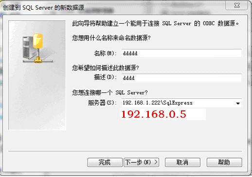

- 名称随意设置，描述也随意设置。
- 服务器（S）:这里需要使用IP地址开头的方式,如本地使用时是.\SqlExpress,就是替换为*IP地址\SqlExpress*。SqlExpress是数据库默认实例名称

        图20:

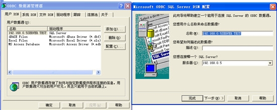

        图21:

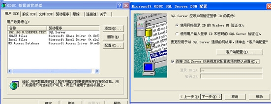

        图22:

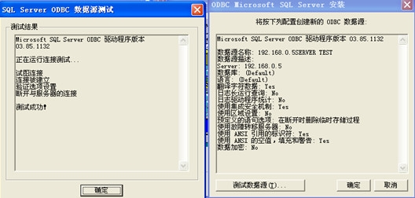

 

## 五.使用DBTools访问数据库测试

1、将另一台电脑的IP设置为与监控主机同一网段(根据主机的IP地址设置，要求能PING通主机)，网络连接主机。

2、在电脑上打开DBTOOL数据库维护工具。数据库服务器：输入访问主机的IP(或主机IP加实例名称如192.168.0.5\SqlExpress)。选择SQL Server认证。用户名：sa 密码：wenejiang(默认，具体要根据现场设置情况)

        图23:

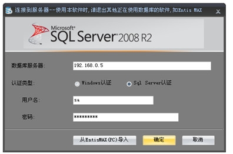

1.登录成功后显示主机数据库。

        图24:

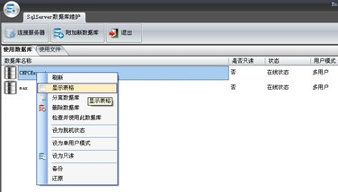

‍
