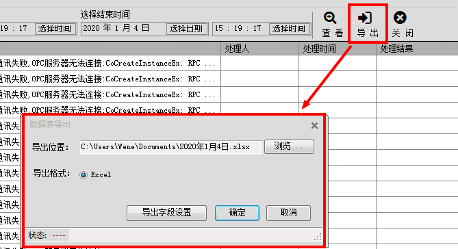

# 消息历史查询

---

### 1:功能描述

    查询消息的历史记录，如作业消息，通讯消息，系统通知消息等

### 2:如何开始使用

打开菜单 "报表查询" => "消息历史查询"：

### 3:操作说明

   设定好开始时间和结束时间,点击按钮"查看",就可以以分页的形式显示历史记录

当前只支持Excel方式的导出,点击"导出"按钮,显示如下的界面,选择好要导出的文件位置,设置好要导出的字段,点击确定,稍等即可导出数据,具体导出时间根据数据量大小不同有所区别

