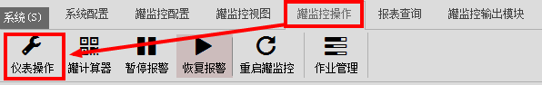
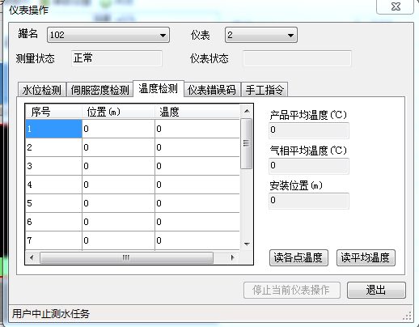

# 仪表操作

---

### 1：功能描述

仪表操作功能包括：执行温度检测、读取仪表错误码、手工指令、水位检测、伺服密度检测等。

### 2：如何开始使用

### 3：操作说明

直接点击按钮 "开始测量"，会有对话框确认，确认后伺服液位计会执行测水操作。根据罐内液位不同，执行测量时间也有所不同，一般为 5 分钟左右：

点击按钮 "开始测量"，弹出确认框，确认后开始测量。根据罐液位高度不同，测量时间也不同，一般为 15 分钟左右，请耐心等待：

- 点击"读取错误码",执行错误码读取
- 点击"保存错误码",可以把错误码保存为文件文件
- 点击"清除",可以把读取的错误码清除掉

可以输入手工命令，或者通过列表选择手工命令执行：

---

‍
