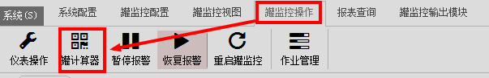
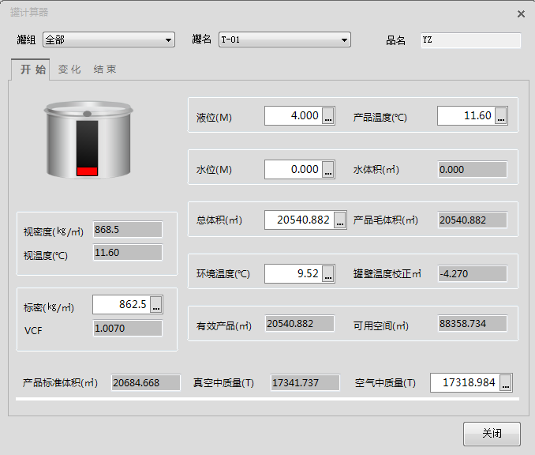
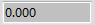
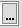

# 罐计算器

**摘要**：实现罐量计算

- 通过基础液位，温度，密度数据计算体积和质量
- 通过输入质量和体积，倒算液位（此计算不是精确计算，会有估算部份，所以会有误差）
- 通过前尺，后尺数据计算变化量，
- 通过前尺和变化量数据计算后尺

**1：如何进入**

点击菜单【罐监控操作】下面的【罐计算器】按钮，如图：

**2:如何使用**

主界面如下图：

1. 
2. 
3. 
4. 计算规则：
5. 在【前尺】输入值并计算后，【前尺】的相应计算量如体积和质量会发生变化，同时会根据【前尺】和【后尺】的数据进行变化更新中间【变化】部分。
6. 在中间【变化】部分输入值后，不会影响【前尺】数据，会根据【前尺】和【变化】的数据计算更新【后尺】数据。
7. 在【后尺】输入值并计算后，不会影响【前尺】数据，会根据【前尺】和【后尺】的数据计算更新【变化】部分数据。

**3:其他说明**

- 【变化】中的到限时间根据进出罐区分，如进罐则表示到达最大安全容量时的时间，如出罐则表示到达最小安全容量时的时间
- 【变化】中的标密是【前尺】和【后尺】的变化部份
- 在罐计算器中进行计算时，会按照选择罐在系统中的配置进行计算，所以相关计算值请参考罐的计算参数配置，如是否开启水份计算，是否开启罐壁修正
