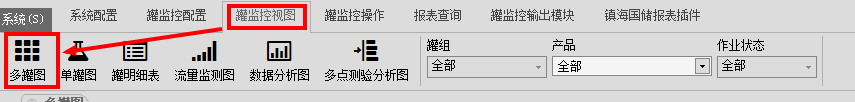
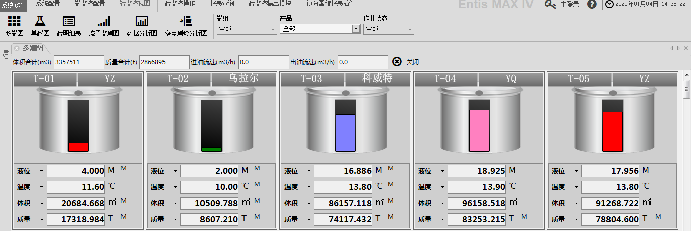
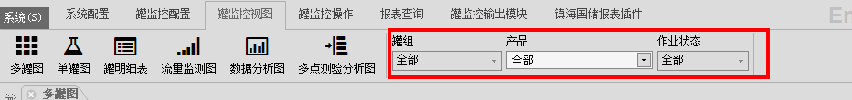

# 多罐图

---

### 1:功能描述

- 以缩略图的形式显示当前罐组所有罐主要数据信息,液位,温度,体积和质量

### 2:如何开始使用

- 启动罐监控模块，默认显示的就是多罐图。
- 如当前显示的不是多罐图，则依次打开菜单 "罐监控视图" => "多罐图"，如图：

  
- 

### 4:操作说明

当在多罐图中点击选择了某一个罐后，可以点击左上角的 "仪表操作" 按钮，执行此罐的仪表操作。

---

‍
