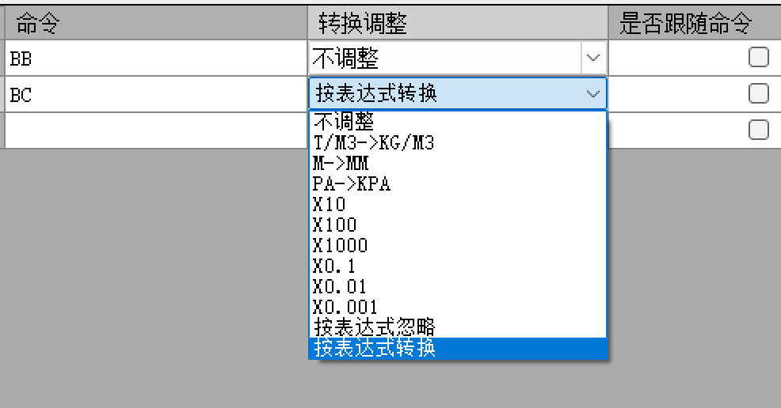

# 按表达式忽略功能说明

# 按表达式忽略 ― 使用说明

## 功能简介

**按表达式忽略**用于在读取仪表数据时，根据您设置的条件判断当前读数是否应被**丢弃**。

- 当表达式判断为 **真** 时：本次读数被忽略，不会更新到界面或后续计算。
- 当表达式判断为 **假** 时：读数正常参与后续处理。

常见用途：

- 过滤明显异常的读数，例如：​`value < -200 OR value > 200`
- 忽略等于特定无效值的读数，例如：​`value = 9999`
- 忽略超出合理区间的数据，例如：​`value < 0 OR value > 100`

> **说明：**  本功能用于**判断是否忽略读数**，不会修改读数本身。若需要对读数进行换算，请使用  **「按表达式转换」** ，两者互不影响。

---

## 如何配置

1. 打开 **储罐 / 仪表配置**。
2. 进入该仪表的 **Modbus 数据地址** 配置页。
3. 在列表中找到要设置的数据项（如液位、温度等）。
4. 在 **单位转换** 下拉框中选择  **「按表达式忽略」** 。
5. 在弹出的对话框中填写表达式，点击 **确定** 保存。

---

### 表达式规则

- 表达式应写成判断条件，结果为「真」或「假」。
- 匹配（结果为真）的读数将被忽略。
- 每个数据项可单独配置一条表达式。

支持的运算符：

- 比较：​`<`​、​`>`​、​`<=`​、​`>=`​、​`<>`​（不等于）、​`=`
- 逻辑运算：​`OR`​、​`&&`​、​`||`
- 示例：

  - 忽略小于0或大于100的读数：​`value < 0 OR value > 100`
  - 忽略在0～100之间的读数：​`value >= 0 AND value <= 100`

注意事项：

1. `value` 是已完成偏移、精度等常规处理之后的读数，不是寄存器原始值。
2. 本功能仅影响读取，不影响写入。
3. 请确保条件逻辑符合现场需求：写错条件可能导致正常读数被误忽略，或异常读数未被过滤。
4. 仅适合简单比较与逻辑组合，不支持复杂函数或文字处理。

---

## 常用示例

|需求|表达式|说明|
| ----------------------| --------| -------------------------------------|
|忽略过小或过大的读数|`value < -200 OR value > 200`|超出 ±200 范围的读数被丢弃|
|忽略特定无效值|`value = 9999`|读数为 9999 时不更新|
|忽略负值|`value < 0`|负值读数被丢弃|
|忽略零值|`value = 0`|读数为 0 时不更新|
|忽略合理区间内的读数|`value >= 10 AND value <= 90`|10～90 之间的读数被丢弃（较少使用）|

---

检查表达式时注意：

1. 运算符（​`>`​、​`<`等）、比较符号是否正确、括号是否配对；
2. 可先用 ​`value > 0` 等简单表达式测试功能。

---

## 修订记录

|版本|日期|说明|
| ------| ------------| ------|
|1.0|2026-07-02|初版|
