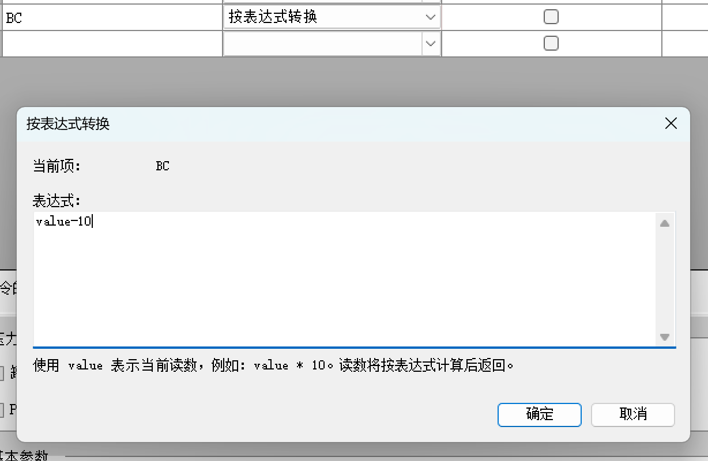
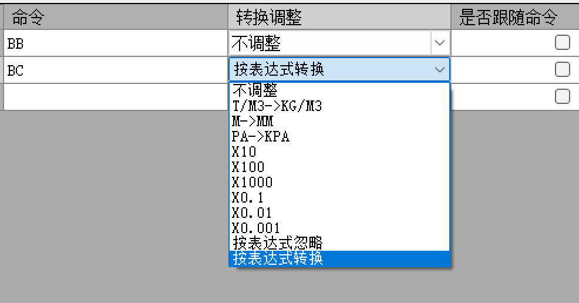

# 按表达式转换功能说明

# 按表达式转换 ― 使用说明

## 功能简介

**按表达式转换**用于在读取仪表数据时，按您编写的公式对读数进行计算，得到最终显示值。

常见用途：

- 读数放大或缩小，例如：​`value * 10`
- 加上或减去固定数值，例如：​`value + 273.15`
- 单位换算，例如：​`(value - 32) * 5 / 9`
- 负值归零等简单处理

> **说明：**  本功能用于**算出新的读数**。若只需判断读数是否满足条件、决定是否忽略，请使用  **「按表达式忽略」** ，两者互不影响。

---

## 如何配置

1. 打开 **储罐 / 仪表配置**。
2. 进入该仪表的配置页，当前支持 *Modbus* 和 *GPU* 协议。
3. 在列表中找到要设置的数据项（如液位、温度等）。
4. 在 **单位转换** 下拉框中选择  **「按表达式转换」** 。
5. 在弹出的对话框中填写表达式，点击 **确定** 保存。

---

## 如何编写表达式

### 表达式规则

- 支持基本算术运算：​`+`​、​`-`​、​`*`​、​`/`​、​`IIF(条件, 结果1, 结果2)`（条件判断函数）
- 小数点请使用​`.`（英文句号）
- 每个数据项可单独配置一条表达式

### 示例

读数为负时显示0，否则保持原值：  
​`IIF(value < 0, 0, value)`

注意事项：

1. `value`是已完成偏移、精度等常规处理之后的读数，不是寄存器原始值。
2. 本功能仅影响读取显示，不影响写入。
3. 请避免除以0等会导致计算失败的写法。
4. 仅适合简单算术运算，不支持复杂函数或文字处理。

---

## 常用示例

|需求|表达式|说明|
| ----------------| --------| -----------------|
|放大10倍|`value * 10`|12.5 → 125|
|加固定值|`value + 273.15`|25 → 298.15|
|华氏度转摄氏度|`(value - 32) * 5 / 9`|212 → 100|
|负值归零|`IIF(value < 0, 0, value)`|-3 → 0，5 → 5|
|缩放并加偏移|`value * 0.1 + 2.5`|100 → 12.5|

---

调试注意：  
检查表达式时注意运算符（​`>`​、​`<`​等）、括号是否配对、是否使用了不支持的符号；可先用​`value * 1`等简单表达式测试功能。

---

## 修订记录

|版本|日期|说明|
| ------| ------------| ------|
|1.0|2026-07-02|初版|
