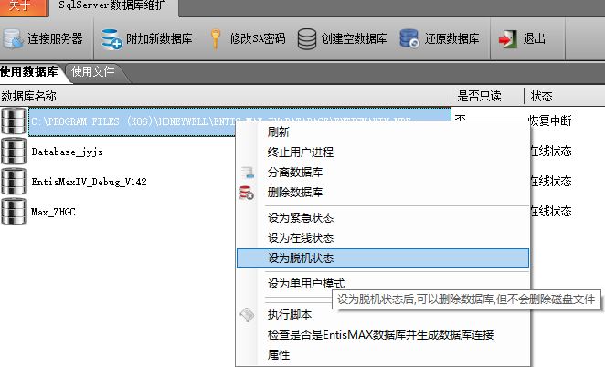

# 数据库服务器连接正常，但数据库无法连接

---

### 1:问题描述

- 启动软件时，系统提示 "数据库连接正常，但连接的数据库不存在"，如下图：

### 2:问题分析

- 原因一（大部份情况）：数据库文件出现问题，如突然停电,权限损坏，硬盘坏道，病毒破坏等各种原因，像突然停电,权限损坏导致的一些轻微故障，可以通过下面的方法进行尝试修复，但如硬盘出现坏道等一些严重的故障原因，数据库文件无法简单修复，一般只能通过还原备份文件方式修复。
- 原因二：通过其他软件把附加的数据库名称修改掉，或链接的数据库文件被移动，如是这些原因导致的，则可以通过再次配置数据库连接来解决问题,操作方法，请参考[《初始化设置向导》](http://softcool-publish.oss-cn-hongkong.aliyuncs.com/Documents/EntisMax/EntisMaxIV/Help/安装卸载说明/EntisMax软件安装/2-初始化设置向导.html)中的数据库连接设定

### 3:数据库轻微故障修复说明

