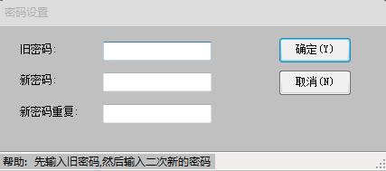

# 密码修改

---

### 1:功能描述

- 登陆用户自行修改登陆密码

### 2：如何开始使用：

- 在主界面右上角，登陆按钮下拉按钮列表中，选择【修改密码】打开如图：
- 

### 3:操作步骤：

- 输入旧密码．
- 输入新密码．
- 重复输入新密码．"确认"按钮亮起．
- 点击"确认"按钮完成修改．

---

注意事项:

- 只有当输入正确后,"确定"按钮才会亮起．
