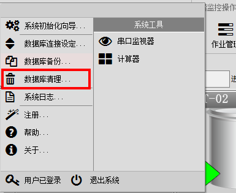
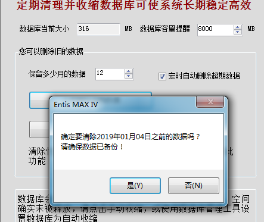
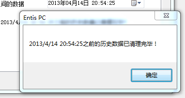
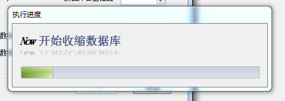
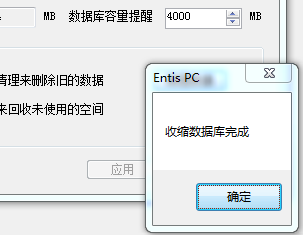

# 数据库清理

### 1:功能描述

- 清除指定时间内的日志数据，业务数据，报警记录等
- 配置数据不会被清理.

### 2:如何开始使用

- 依次打开菜单"系统"-->"数据库清理",如图:

### 3:操作说明

界面会显示当前数据库大小和容量提醒大小,当数据库大小超过此设定值时,系统会提示进行数据库清理

    在一些特殊情况下，系统变得缓慢，历史数据也非常多，无法快速清除所有历史数据，此时可以通过此功能来清除所有历史数据，提高系统执行效率，在执行此功能前，强烈建议先执行备份数据库

点击按钮"手动收缩",会弹出确认提示框,确认后开始执行空间回收,根据数据量不同,时间也不同,但一般会比较快,在1分钟之内,请稍等即可.

弹出完成对话框,表示空间回收完成.

---
