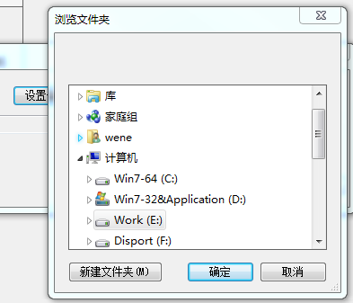
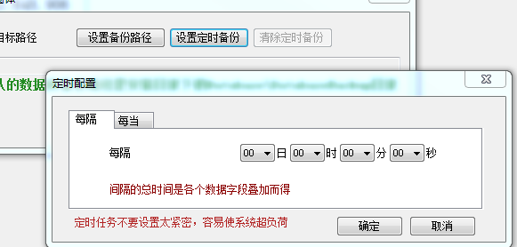
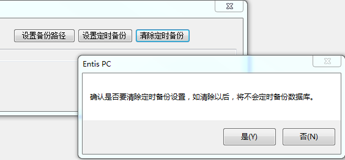

# 数据库的备份

### 1:功能描述

- 执行数据库备份
- 数据库还原请使用附加工具DBTools

### 2:如何开始使用

依次打开菜单 "系统" => "数据库备份"，打开如图：

### 3:操作说明

在上一步设置好备份路径后，点击按钮 "备份"，会显示进度条，表示备份正在进行。根据数据库大小不同，时间也会有所不同，请耐心等待：

##### 点击按钮"设置定时备份",会显示如下窗体,请在窗体中设定定时方式,是按间隔还是时间定来定时进行备份.

---
