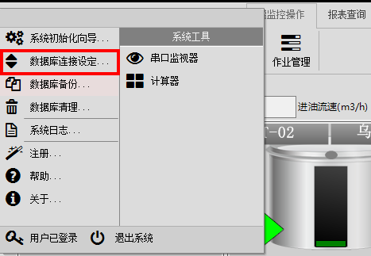
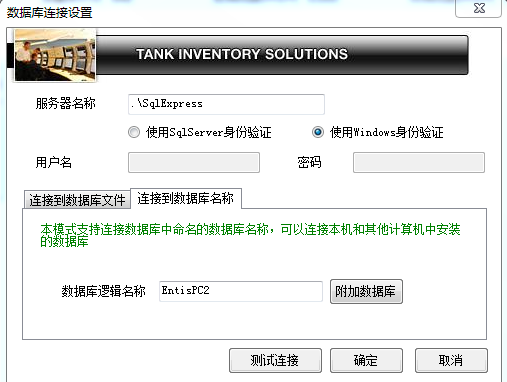
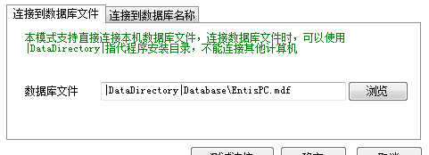

# 数据库连接设定

---

### 1:功能描述

- 重新设定数据库的连接

### 2:如何开始使用

- 选择菜单 "系统" => "数据库连接设定"，如图：

  
- 打开操作界面，如图：

  

### 3:操作说明

正确输入服务器名称一般为默认值.\SqlExpress

- 如果是数据库服务器是本机的,则建议使用Windows身份验证,可以不用输入用户名和密码
- 如果数据库服务器不在本机,则建议使用SqlServer身份验证,配置比较简单,需要输入用户名和密码,用户名一般为sa,密码为安装SqlServer时设置的密码

输入想要使用的逻辑名称。

---
