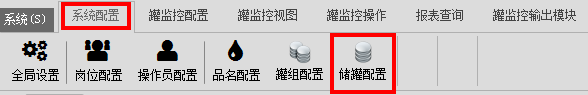
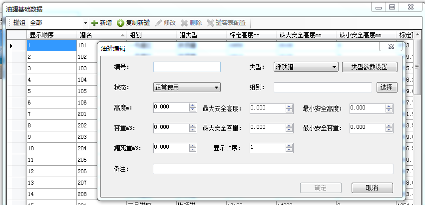
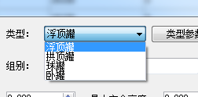
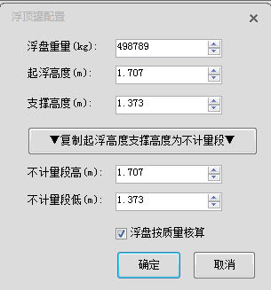
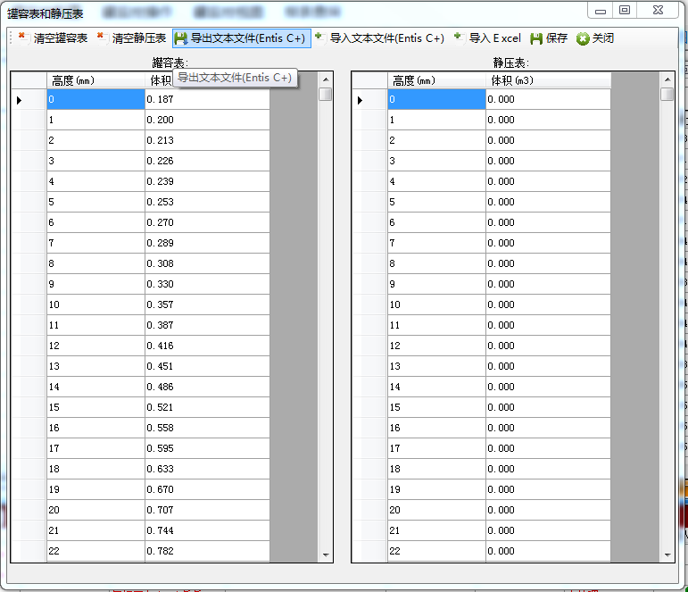
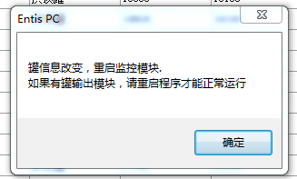

# 储罐配置

---

### 1:功能描述

- 对储罐信息的新增,修改,删除.
- 对储罐的罐容表信息的配置.

### 2:如何开始使用

### 3:操作说明

##### 点击按钮"新增",显示添加储罐界面

---

如要添加的新罐与之前已存在的罐数据非常相似时，可以使用复制功能快速添加。点击按钮 "复制新罐"，只要输入新的罐名即可完成新罐的添加：

选中要修改的罐，点击按钮 "修改"，显示修改界面，修改内容可以参考新增功能：

选中要删除的罐，点击按钮 "删除"，显示确认框：

### 4:罐容表配置

