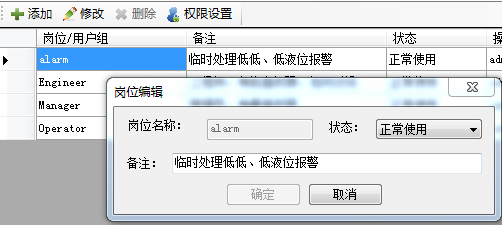

# 岗位配置

---

### 1:功能描述：

- 对岗位基本信息管理.
- 对岗位权限设置
- 默认已设置"管理组","工程师组",“操作员组”三个岗位

### 2:如何开始使用：

- 依次打开菜单 "系统配置" => "岗位配置"，如图：

### 3:操作说明

**添加**：

先点击要删除的记录，点击删除按钮，会显示确认对话框，此时请点击按钮 "是"，删除记录：

请先选择要配置的岗位，然后点击 "权限设置" 按钮：

---
