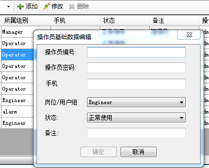
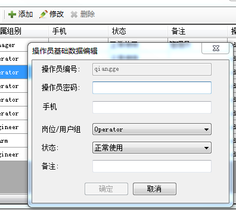

# 操作员配置

---

### 1:功能描述：

- 对操作员基本信息,添加,删除,修改.
- 每个操作员的权限则继承自所属的岗位

### 2:如何开始使用：

依次打开菜单 "系统配置" => "操作员配置"，如图：

### 3:操作说明

选中要修改的操作员,点击"修改"按钮

选中要删除的操作员，点击 "删除" 按钮，显示确认对话框，点击按钮 "是" 执行删除，点击按钮 "否" 取消删除：

---
