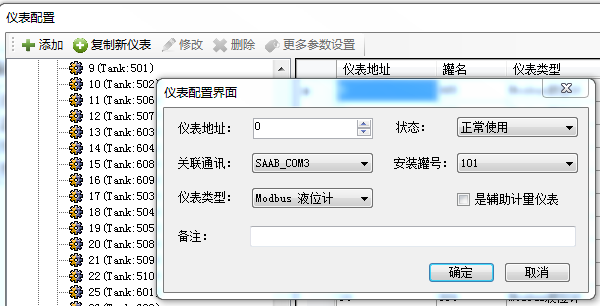
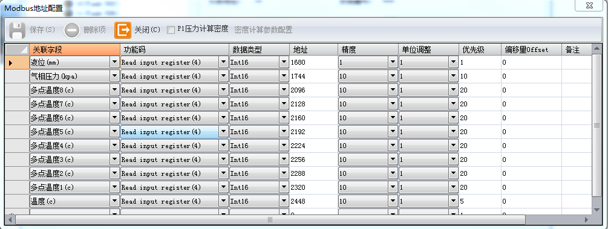
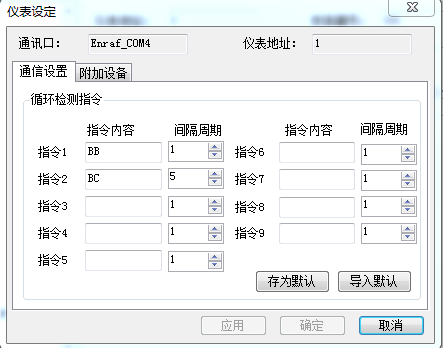
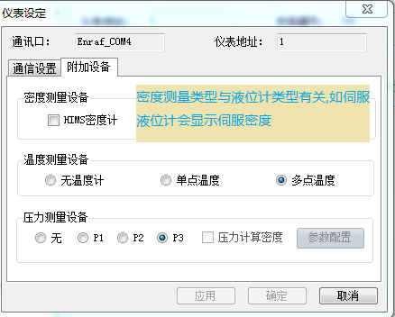

# 仪表配置

### 1:功能描述

- 对液位计仪表信息的新增,修改,删除
- 根据通讯方式不同,仪表的更多参数的配置方法有所区别

### 2:如何开始使用

依次打开菜单 "罐监控配置" => "仪表配置"，如图：

### 3:操作说明

点击"添加"按钮,显示仪表基本信息界面,如图:

当新的仪表和旧的仪表数据相差不多时,可以采用复制的方式,快速加入新的仪表,选中要复制的仪表,加后点击"复制新仪表"按钮,会显示要复制的仪表的数据,只要修改不同的部份,点击确定,即可生成新的仪表

选中要修改的仪表,点击'修改"按钮,会显示仪表基本信息界面.修改完成后,点击确定.

选中要删除的仪表，点击 "删除" 按钮，会显示确认对话框。按 "是" 执行删除，按 "否" 取消删除：

如仪表为 OPC 仪表，则点击更多参数后，会显示 OPC 配置项，如图：

---
