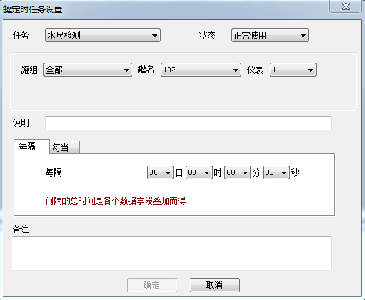

# 定时任务设置

# 定时任务设置

---

### 1：功能描述

    对定时任务的新增,修改,删除.

### 2：如何开始使用

依次打开菜单 "罐监控配置" => "定时任务设置"，如图：

### 3：操作说明

单击"添加"按钮,打开"罐定时任务设置"界面.如图:

如新加的定时任务与已存在的定时任务差不多,则可以通过复制定时任务的方式来新建定时任务,加快效率.选择要被复制的定时任务,点击"复制定时任务"按钮,完成定时任务复制.

选择您要修改的定时任务,单击"修改"按钮,完成定时任务的修改.

选择您要删除的定时任务,单击"删除"按钮,完成定时任务的删除.

---
