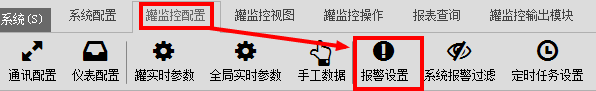
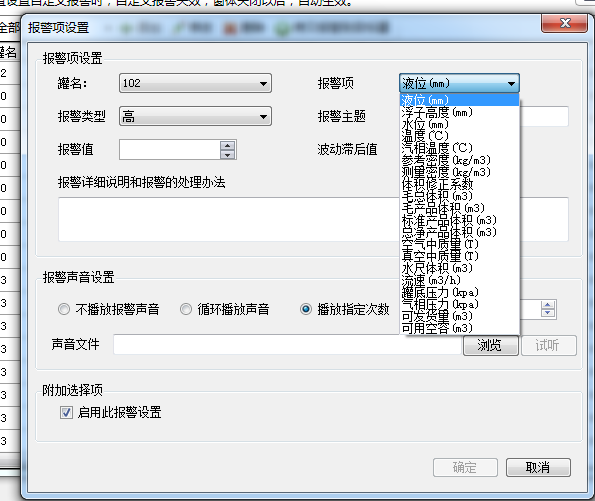

# 报警设置

---

### 1：功能描述：

    对报警信息的设置,此处的报警是由上位机引发的报警,与仪表发送的报警不同

### 2：如何开始使用：

### 打开 "报警设置" 窗口，如图：

单击"新添"按钮,打开"报警项设置"界面.如图: 

选择您要修改的报警信息,单击"修改"按钮,显示修改窗体,具体操作同新增

选择您要删除的报警信息,单击"删除"按钮,显示确认对话框,点击按钮"是"执行删除,点击按钮"否"取消删除 

如将要配置的罐的报警设置与已经配置的罐一样，则在工具栏选择已经配置的罐，然后点击按钮 "拷贝报警到目标罐"，显示复制对话框：

---
