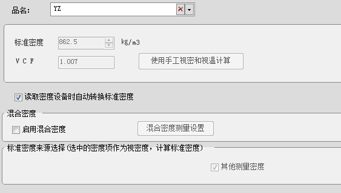
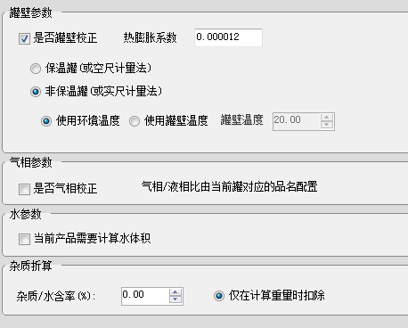
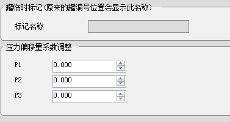

# 罐实时参数设置

### 1:功能描述

- 对罐实时参数的配置,包括"罐状态设置","流速设置","产品和密度","罐计算参数配置","其他设置"等

### 2:如何使用：

- 依次打开菜单 "罐监控配置" => "罐实时参数设置"，如图：
- 打开 "罐参数配置" 窗口，如图：

### 3:操作说明

##### 罐状态设置

##### 流速设置

##### 

‍

---
