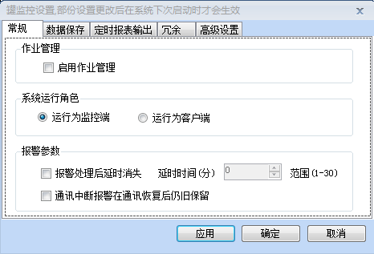
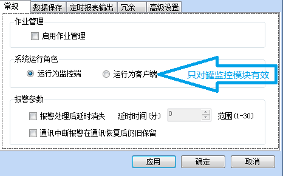

# 罐监控选项

---

### 1：功能描述

- 罐监控模块的选项设置界面,包括"基本设置","数据保存","定时报表输出","冗余设置","高级设置".

### 2：如何开始使用

依次打开菜单 "罐监控配置" => "罐监控选项"，如图：

### 3：操作说明

##### 

主要设置罐的实时数据和历史数据的保存时间。一般请不要随便改动，尽量不要把时间调快，除非你安装的数据库版本和电脑性能都比较好。

此处针对的输出报表是罐数据即时报表。如需要定时输出其他报表，需要专门定制扩展模块：

此处一般情况下不用改动：

---
